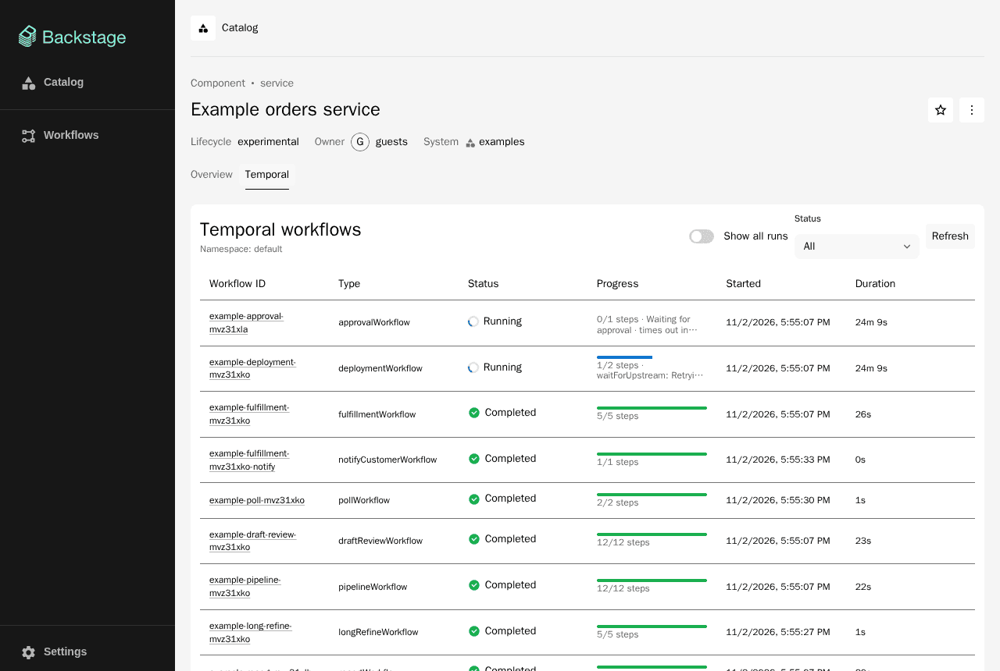
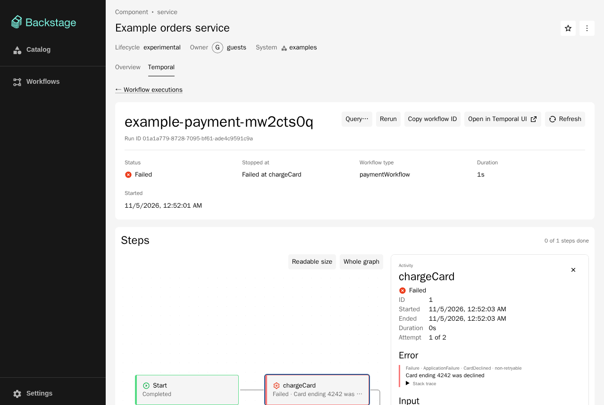
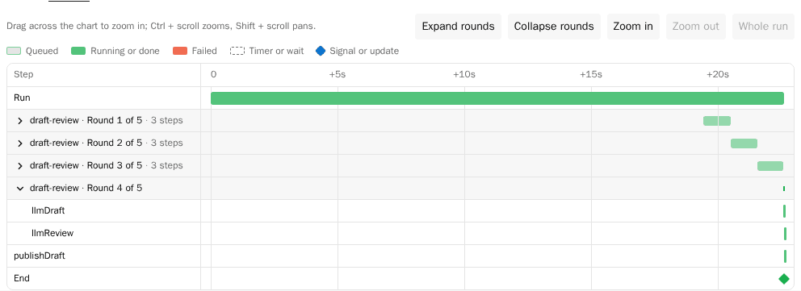
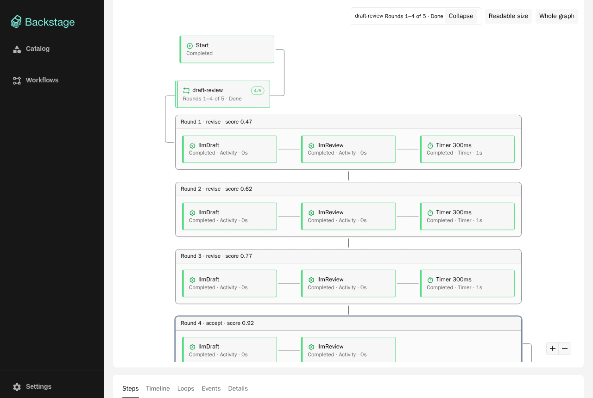
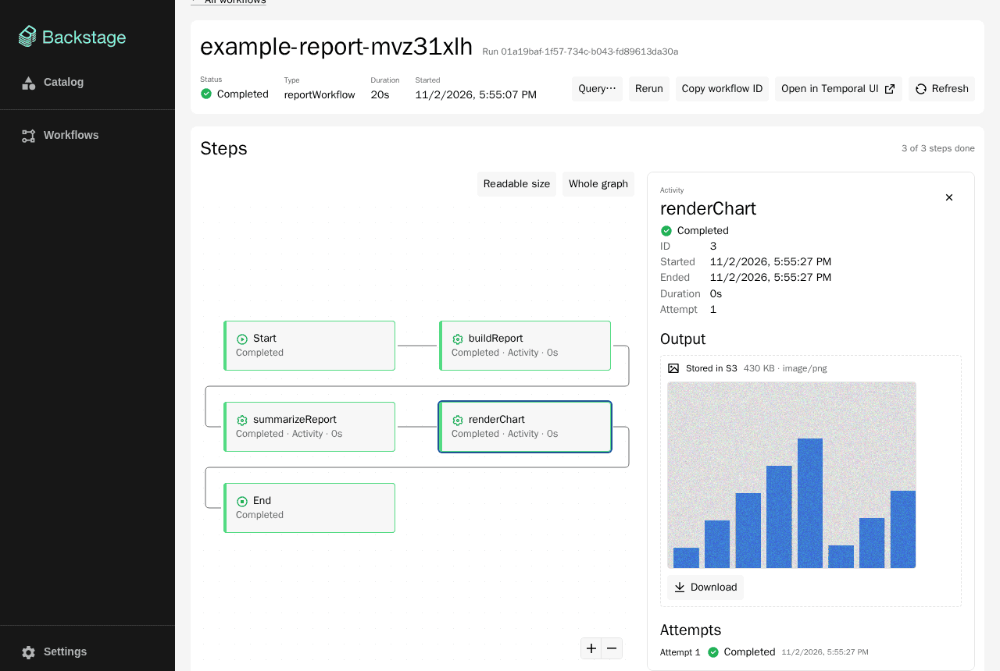
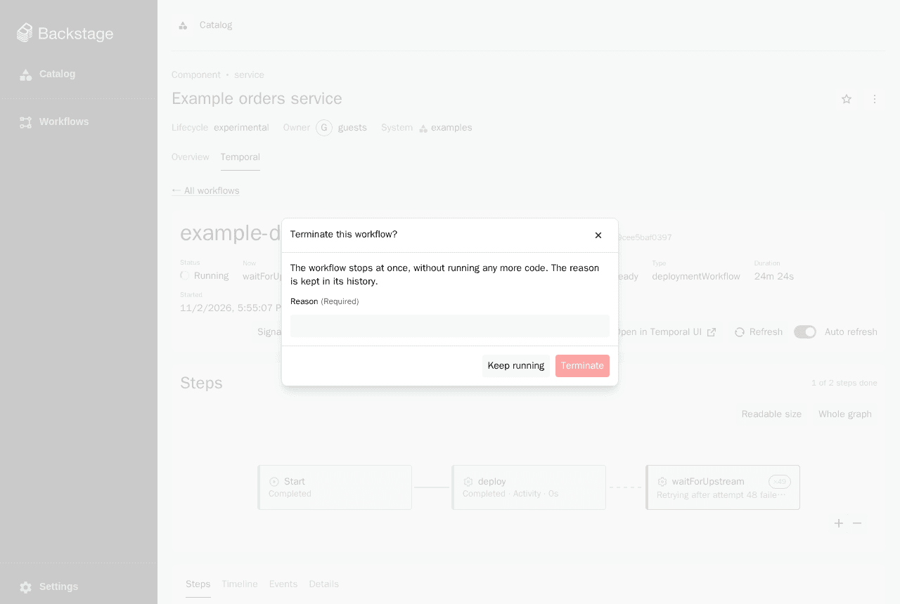
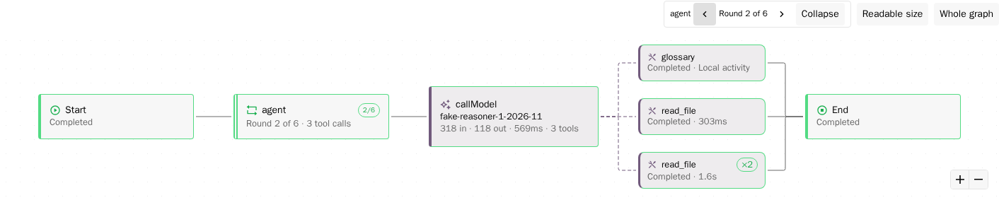
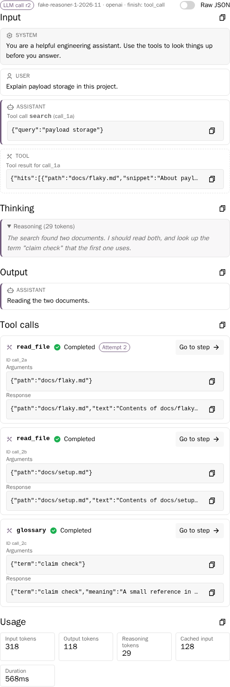
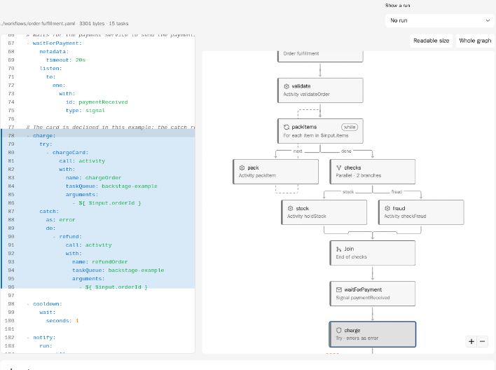
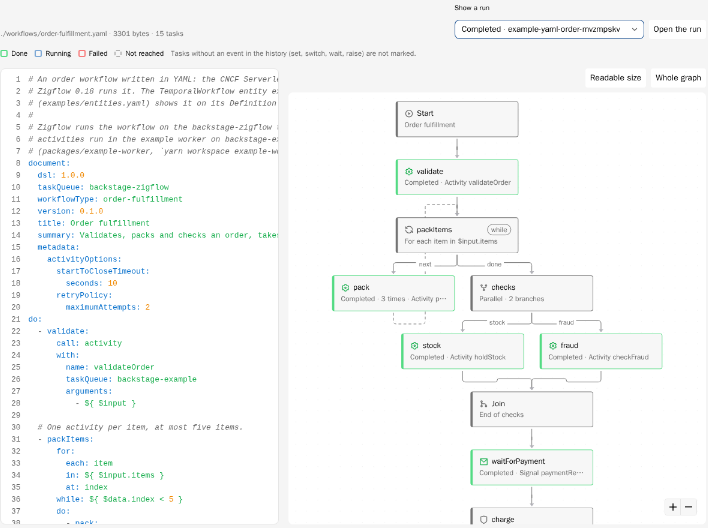

# Backstage plugin for Temporal

> **Unofficial.** This project is a community plugin. It is not affiliated with,
> endorsed by, or supported by Temporal Technologies, Inc. or the Backstage
> project. "Temporal" is used only to describe what the plugin connects to.

**Status: pre-release.** The first release will be `0.1.0`. Until `1.0.0`,
minor versions may change the API.

The plugin shows [Temporal](https://temporal.io) workflows next to the catalog
entities that own them in [Backstage](https://backstage.io), and lets people
operate them from there, with every operation checked by the Backstage
permission framework and recorded with the auditor.

## Features

- **Workflows of an entity.** A **Temporal** tab on catalog entities lists
  their workflow executions with status, times and the progress of each run
  (steps done, the current step or the failure).
- **Step graph.** The details page of a run is built around a graph of its
  steps: activities with their attempts, timers, signals, updates, child
  workflows and the wait the run is in. Selecting a step opens a panel with
  its input, output, error, attempts and events.
- **Timeline.** The same steps on a time axis: how long each step waited for
  a worker and how long it ran, retries, timers and waits, signals and
  updates. Bars of a running workflow grow until now; the chart zooms.
- **Loops of AI workflows.** Rounds of generate, check and revise loops are
  grouped into one box in the graph, one group per round in the timeline,
  and one row per round in the **Loops** tab, across continue-as-new runs
  (with `@kwkevinchan/temporal-workflow-kit/loop`, see
  [the workflow kit](plugins/temporal-workflow-kit)).
- **LLM steps of agent workflows.** Each model call is a box with the
  model, tokens, duration and number of tools; the tools it asked for hang
  off it. Its panel shows the input, the thinking, the output, the tool
  calls and the usage. The records follow the OpenTelemetry GenAI
  conventions (with `@kwkevinchan/temporal-workflow-kit/llm`, see
  [LLM steps](#llm-steps)).
- **Workflow definitions.** A **Definition** tab on `TemporalWorkflow`
  entities shows a workflow written in YAML (CNCF Serverless Workflow DSL
  1.0, as [Zigflow](https://github.com/zigflow/zigflow) runs it) next to its
  graph: selecting a task in one selects it in the other, and a run can be
  laid over the graph (done, running, failed, not reached). Workflows written
  in code get links to their source (see
  [Workflow definitions](#workflow-definitions)).
- **Large payloads in S3.** Payloads that workers store in an S3-compatible
  store with `@kwkevinchan/temporal-workflow-kit/s3`
  are shown as JSON, as a preview or as an image, and can be downloaded
  through the backend.
- **Workflow controls.** Start, signal, update, query, cancel, terminate and
  rerun workflows, and add your own actions.
- **Workflow entities.** A `TemporalWorkflow` catalog kind for one workflow
  type, and a **Workflows** page with every workflow of a namespace.

| Workflows of an entity                                           | Step graph and step panel                                        |
| ---------------------------------------------------------------- | ---------------------------------------------------------------- |
|         |  |
| **Timeline**                                                     | **Loop rounds**                                                  |
|          |             |
| **Large payload in S3**                                          | **Workflow controls**                                            |
|              |                     |
| **A model call and its tool calls**                              | **LLM panel**                                                    |
|  |           |

## Packages

| Package                                                                                                    | Role                  | Install in        | Purpose                                                                                                                                                                              |
| ---------------------------------------------------------------------------------------------------------- | --------------------- | ----------------- | ------------------------------------------------------------------------------------------------------------------------------------------------------------------------------------ |
| [`@kwkevinchan/backstage-plugin-temporal`](plugins/temporal)                                               | frontend-plugin       | Backstage app     | Entity tab, workflow details, Workflows page. Legacy entry point; `./alpha` for the new frontend system with the blueprints for workflow actions and sections.                       |
| [`@kwkevinchan/backstage-plugin-temporal-backend`](plugins/temporal-backend)                               | backend-plugin        | Backstage backend | REST API under `/api/temporal`: read and control workflows, permission checks. Also the Temporal client service, the extension point, and the permissions and types for your policy. |
| [`@kwkevinchan/backstage-plugin-catalog-backend-module-temporal`](plugins/catalog-backend-module-temporal) | backend-plugin-module | Backstage backend | Catalog module with the `TemporalWorkflow` kind (optional).                                                                                                                          |
| [`@kwkevinchan/temporal-workflow-kit`](plugins/temporal-workflow-kit)                                      | node-library          | Your workers      | Not a Backstage package. `/s3`: payload codec, large payloads in S3 with a claim check in the history. `/loop`: loop markers, a loop state query and continue-as-new helpers.        |

Which ones to install:

- **Everyone:** the frontend plugin in the app and the backend plugin in the
  backend.
- **With `TemporalWorkflow` entities:** also the catalog module in the
  backend.
- **With large payloads in S3, or loops of AI workflows:** the workflow kit
  in your Temporal workers (not in Backstage). The backend reads the claim
  checks itself and only needs `temporal.payloads.s3`.

Plugins and app modules that add buttons or tabs to the workflow page use the
frontend plugin (`./alpha` for the blueprints); backend modules and
permission policies use the backend plugin.

Development-only packages (never published): `packages/app` (legacy frontend
system), `packages/app-next` (new frontend system), `packages/backend` and
`packages/example-worker`.

## Compatibility

| Component       | Supported                                                                                                                                                                                                        |
| --------------- | ---------------------------------------------------------------------------------------------------------------------------------------------------------------------------------------------------------------- |
| Backstage       | **1.56.x** only (see `backstage.json`). Both frontend systems: legacy (`EntityPage.tsx`) and new (`./alpha`).                                                                                                    |
| Temporal server | Tested with **1.32** (self-hosted, and the development server of the Temporal CLI 1.9).                                                                                                                          |
| Temporal SDK    | The backend uses `@temporalio/client` **1.24**. `@kwkevinchan/temporal-workflow-kit/loop` needs `@temporalio/workflow` 1.12 or later (tested with 1.24); `/s3` works with the TypeScript SDK (tested with 1.24). |
| Node.js         | 22 or 24.                                                                                                                                                                                                        |

The screens use the Backstage design system `@backstage/ui`; the app must
load its styles (`import '@backstage/ui/css/styles.css'`, as apps created for
1.56 do). Light and dark themes follow the app theme. The step graph uses
[React Flow](https://reactflow.dev) (`@xyflow/react`) with the
[dagre](https://github.com/dagrejs/dagre) layout, both MIT licensed; the
timeline is drawn with plain HTML and CSS. The YAML of the Definition tab
is colored with `react-syntax-highlighter` (MIT, already in every app through
`@backstage/core-components`) and only the YAML grammar of highlight.js
(BSD-3-Clause): about 40 KB minified (14 KB gzipped), loaded with the tab.
The backend parses YAML with [`yaml`](https://eemeli.org/yaml/) (ISC).

## Installation

### Backend

```sh
yarn --cwd packages/backend add @kwkevinchan/backstage-plugin-temporal-backend
# Optional: the TemporalWorkflow kind.
yarn --cwd packages/backend add @kwkevinchan/backstage-plugin-catalog-backend-module-temporal
```

`packages/backend/src/index.ts`:

```ts
backend.add(import('@kwkevinchan/backstage-plugin-temporal-backend'));
// Optional: the TemporalWorkflow kind.
backend.add(
  import('@kwkevinchan/backstage-plugin-catalog-backend-module-temporal'),
);
```

The backend plugin needs the catalog and the permission framework. It only
uses `@temporalio/client` (no worker code runs inside Backstage). Add at
least `temporal.connection` to your app config (see
[Configuration](#configuration)).

**Content security policy.** With large payloads in S3, the step panel shows
stored images as thumbnails from `blob:` URLs. The backend's default content
security policy does not allow them, so in production (where the backend
serves the app) add `blob:` to `img-src`, or the thumbnails stay empty:

```yaml
backend:
  csp:
    img-src: ["'self'", 'data:', 'blob:']
```

`backend.csp` replaces the default list of a directive, so keep `'self'` and
`data:`. The development server of the frontend (`yarn start`) does not send
this header, so the problem only shows in a production build.

### Frontend, new frontend system

```sh
yarn --cwd packages/app add @kwkevinchan/backstage-plugin-temporal
```

Add the plugin to your app features, or let feature discovery find it:

```ts
import temporalPlugin from '@kwkevinchan/backstage-plugin-temporal/alpha';

export default createApp({ features: [temporalPlugin /* ... */] });
```

This adds a **Temporal** tab to entities of any kind that have Temporal
annotations, to `TemporalWorkflow` entities and to entities that depend on
them; a **Definition** tab to `TemporalWorkflow` entities; a summary card on the overview of `TemporalWorkflow` entities; a card
with the workflow entities on the overview of entities that depend on them;
and the **Workflows** page on `/temporal`. The page has a title and an icon,
so the app lists it in the sidebar with the nav items it discovers from pages
(`navItems` of `NavContentBlueprint`).

### Frontend, legacy frontend system

```sh
yarn --cwd packages/app add @kwkevinchan/backstage-plugin-temporal
```

`EntityPage.tsx`:

```tsx
import {
  EntityTemporalContent,
  isTemporalAvailable,
} from '@kwkevinchan/backstage-plugin-temporal';

<EntityLayout.Route path="/temporal" title="Temporal" if={isTemporalAvailable}>
  <EntityTemporalContent />
</EntityLayout.Route>;
```

Add the route to the entity page of every kind that can carry the
annotations; the plugin does not depend on the entity kind.

For `TemporalWorkflow` entities, add a page to the `EntitySwitch`:

```tsx
import {
  EntityTemporalDefinitionContent,
  EntityTemporalRelatedWorkflowsCard,
  EntityTemporalWorkflowSummaryCard,
  getDependsOnTemporalWorkflowRefs,
  isTemporalWorkflowEntity,
} from '@kwkevinchan/backstage-plugin-temporal';

const temporalWorkflowPage = (
  <EntityLayout>
    <EntityLayout.Route path="/" title="Overview">
      <Grid container spacing={3}>
        <Grid item md={6} xs={12}>
          <EntityAboutCard />
        </Grid>
        <Grid item md={6} xs={12}>
          <EntityTemporalWorkflowSummaryCard />
        </Grid>
      </Grid>
    </EntityLayout.Route>
    <EntityLayout.Route path="/temporal" title="Temporal">
      <EntityTemporalContent />
    </EntityLayout.Route>
    <EntityLayout.Route path="/definition" title="Definition">
      <EntityTemporalDefinitionContent />
    </EntityLayout.Route>
  </EntityLayout>
);

<EntitySwitch>
  <EntitySwitch.Case
    if={isTemporalWorkflowEntity}
    children={temporalWorkflowPage}
  />
  {/* ... */}
</EntitySwitch>;
```

`EntityTemporalRelatedWorkflowsCard` lists the workflow entities of a
component (use it with
`if={e => getDependsOnTemporalWorkflowRefs(e).length > 0}`), and
`EntityTemporalWorkflowStatsCard` shows the recent run statistics on its own.

The Workflows page (`App.tsx` and the sidebar in `Root.tsx`):

```tsx
import { TemporalPage } from '@kwkevinchan/backstage-plugin-temporal';
import AccountTreeIcon from '@material-ui/icons/AccountTree';

<Route path="/temporal" element={<TemporalPage />} />;

<SidebarItem icon={AccountTreeIcon} to="temporal" text="Workflows" />;
```

## Workflow details

The details page of a run shows, from top to bottom:

- a summary line: status, where the run is now (what it waits for, or the
  step it failed at), workflow type, duration and start time, the link to
  the Temporal UI and a refresh button. Running workflows reload every five
  seconds; the **Auto refresh** switch turns this off.
- the step graph: one box per step and arrows between them. Colors follow
  the status, running steps pulse, waiting steps are dashed, retried
  activities show their attempt (`×3`), and a child workflow links to its own
  details. The graph can be zoomed, panned and fitted to the view. Selecting
  a step opens a panel with its input, output, error, attempts and events.
- tabs: **Steps** (a table of the steps), **Timeline** (see below),
  **Events** (grouped by step, or the raw history), **Details** (the summary table, failure, pending activities,
  search attributes and memo), and one tab per workflow section.

### Timeline

The **Timeline** tab draws the steps of the run on a time axis, one row per
step, oldest first, with offsets from the start of the run (`+1m 30s`):

- activities and child workflows: a light bar for the time the step waited
  for a worker (scheduled to started; for a retried activity this includes
  the earlier attempts and the retry backoff) and a solid bar for the time it
  ran (started to closed). The label counts retries (`2 retries`).
- colors follow the status like the graph: failed and timed-out steps are
  red. Timers and waits are dashed; signals, updates and the end of the run
  are points.
- the first row is the whole run. For a running workflow, open steps reach
  to now (a vertical line) and grow while the page refreshes.
- steps of a loop are grouped by round; the latest round of each loop is
  open and the others can be expanded (one at a time, or all at once). A
  run that continued as new shows its own rounds only.
- drag across the chart to zoom in to that range; Ctrl (or ⌘) + scroll
  zooms around the pointer, Shift + scroll pans, and **Whole run** zooms
  out. Hovering a bar shows its times, durations and attempts; pressing it
  opens the same step panel as the graph.

The backend builds the steps from the history (`GET .../graph`):

| Step           | Events                                                                                        |
| -------------- | --------------------------------------------------------------------------------------------- |
| Activity       | `ActivityTask*` by scheduled event ID, with the current attempt of pending activities         |
| Timer          | `TimerStarted`, `TimerFired`, `TimerCanceled`                                                 |
| Signal         | `WorkflowExecutionSignaled`; signals sent by the workflow: `SignalExternalWorkflowExecution*` |
| Update         | `WorkflowExecutionUpdate*` by update ID (admitted, accepted, completed, rejected)             |
| Child workflow | `StartChildWorkflowExecution*` and `ChildWorkflowExecution*` by initiated event ID            |
| Marker         | `MarkerRecorded` (for example local activities)                                               |
| Start and end  | `WorkflowExecutionStarted` and the closing event, including continue-as-new                   |

Workflow task events are internal steps, hidden unless a workflow task
failed (the grouped event view can show them). A step B follows a step A when
B started after A ended (by event ID); steps whose time ranges overlap, like
activities scheduled together, become parallel branches. A running workflow
with nothing open gets a **Waiting** step. Its text comes from a search
attribute whose name ends with `Pending` and whose value is true, for example
`ApprovalPending` gives "Waiting for approval"; without one it says "Waiting
for an external event (signal or update)", since the history does not tell
which signal or update handler the workflow waits for.

Limits: Temporal records only the last attempt of an activity and the
failure of the attempt before it, so earlier attempts are not listed.
Updates rejected by a validator are not written to the history. The backend
reads at most 5000 events per run; the graph of a longer history shows its
start and says so.

Workflow lists keep their filters, page and page size in the URL
(`?status=Running&page=2&pageSize=50`), so the browser's back button and the
**All workflows** link of the details page return to the same page, at the
same scroll position. Temporal's page tokens are kept in the browser's
session storage; when they are gone (another tab), the list opens on the
first page and says so.

Workflow lists show a progress column (done steps and the current step or
failure). It is loaded for the rows on screen only, with at most four
requests at a time; the backend reads at most 1000 events per run for it and
keeps the progress of closed runs in memory.

## Loops

AI workflows often loop: generate, check, and revise when the check fails,
for dozens of rounds and across continue-as-new runs. Drawn step by step,
such a graph becomes unreadable. When the activities and child workflows of
each round carry a loop marker (`loop/<loop>/<round>/<step>` in the activity
ID; see [`@kwkevinchan/temporal-workflow-kit`](plugins/temporal-workflow-kit)
for the format and a TypeScript helper, `/loop`):

- the graph shows each loop as one box, `draft-review · Round 4 of 5 · Done`,
  with the steps before it and after it. Pressing the box, or **Expand**
  above the graph, shows the steps of one round; the arrows above the graph
  step through the rounds. Timers and signals that start during a round
  belong to it.
- the **Loops** tab has one table per loop: each round with its steps,
  status, duration, decision and score, newest first. Pressing a round shows
  it in the graph. Rounds of a workflow that continued as new are counted
  across its runs (`GET .../loops` reads up to 20 runs); a round of another
  run links to that run, opened at the round.
- the limit, the state (`running`, `done`, `exhausted`, `failed`) and the
  decisions and scores come from the `temporal.loops` memo the helper
  upserts after each round, and for a running workflow from its
  `__loop_state` query when a worker answers within three seconds.

Workflows without markers look as before. The loop data needs the read
permission, like the graph; inputs and results are not part of it.

## LLM steps

LLM agents call a model, run the tools it asks for, and call it again. When
the activity of each model call returns a record of the call and the
activities of the tools carry a marker (see
[`@kwkevinchan/temporal-workflow-kit`](plugins/temporal-workflow-kit#llm-llm-steps-of-agent-workflows)
for the format, a TypeScript recorder and converters for OpenAI, Anthropic
and Ollama, `/llm`):

- the graph draws a model call as a larger box with the model, the input and
  output tokens, the duration and the number of tools. The tool calls it
  asked for are smaller boxes with the tool name, joined to it by dashed
  arrows, so an agent loop reads as model call, tools, model call. Retries
  of a tool show on its box.
- selecting a model call opens the LLM panel: **Input** (system
  instructions and messages as a chat, long texts collapsed), **Thinking**
  (collapsed), **Output**, **Tool calls** (name, arguments, response,
  status, and a button to the step of the tool) and **Usage** (input,
  output, reasoning and cached tokens, duration). Every section has a copy
  button; **Raw JSON** shows the record as the worker wrote it. A tool step
  links back to its model call.
- the **Loops** tab adds the tokens of each round and of the loop, and marks
  model and tool calls; the **Timeline** marks them too.

The format:

- activity ID `llm/<call>[/...]` for a model call and
  `tool/<call>/<tool call ID>[/...]` for a tool call; a loop marker may
  follow (`llm/r2/loop/agent/2/callModel`). Read without the payload codec.
- the result of a model call holds the record under `temporal.llm`: the
  attributes of the
  [OpenTelemetry GenAI semantic conventions](https://github.com/open-telemetry/semantic-conventions-genai)
  (`gen_ai.request.model`, `gen_ai.usage.input_tokens`,
  `gen_ai.input.messages`, `gen_ai.output.messages` with parts `text`,
  `reasoning`, `tool_call`, `tool_call_response`, ...), version
  `gen-ai-dev/1.42.0-dev`. Large records go to S3 like any payload.

The graph, the Loops tab and the timeline need the read permission and show
names and numbers only (model, tokens, tool names). The messages, the
thinking and tool arguments and results need
`temporal.workflow.history.read`, like inputs and results
(`GET .../llm-calls/:eventId`). Workflows without markers look as before.

## Workflow definitions

Workflows written in YAML can show their definition on the **Definition**
tab of their `TemporalWorkflow` entity. The format is the CNCF Serverless
Workflow DSL 1.0 (now called the Open Workflow Specification) in the flavor
that [Zigflow](https://github.com/zigflow/zigflow) 0.18 runs on Temporal:
`document.dsl: 1.0.0`, `document.workflowType` and `document.taskQueue`
(the standard `document.name` works too).

| Definition tab: YAML and graph                        | A run on top of the graph                                         |
| ----------------------------------------------------- | ----------------------------------------------------------------- |
|  |  |

### The entity

```yaml
apiVersion: temporal.io/v1alpha1
kind: TemporalWorkflow
metadata:
  name: order-fulfillment
spec:
  owner: group:default/orders-team
  workflowType: order-fulfillment
  taskQueue: orders-zigflow
  definition:
    format: serverless-workflow
    target: ./workflows/order-fulfillment.yaml
```

`spec.definition` has two fields, both required:

| Field    | Meaning                                                                                                                                           |
| -------- | ------------------------------------------------------------------------------------------------------------------------------------------------- |
| `format` | `serverless-workflow`. The only format for now; the field leaves room for others without guessing from the file.                                  |
| `target` | A path relative to the file the entity was read from (`backstage.io/managed-by-location`), or an absolute `http(s)` URL. At most 2048 characters. |

Why this shape: `target` means the same as `spec.target` of Backstage
`Location` entities (relative or absolute), and an object with a `format`
can take other DSLs later. The file is not inlined into the entity (as
`$text` placeholders of API entities are): the catalog would store a copy
of every file in every entity, without the size limit and the checks below,
and would show changes only after the next refresh. The backend reads the
file when the tab opens instead.

Workflows written in code leave `spec.definition` out. Their Definition tab
links to the source from the `backstage.io/source-location` and
`backstage.io/view-url` annotations, without reading any file.

### Reading the file

- The backend reads the file with Backstage's URL reader, so only hosts of a
  configured integration (or `backend.reading.allow`) are read. A relative
  `target` is resolved against the entity's location with the integration's
  rules. Other URL schemes are rejected.
- Files above `temporal.definitions.maxBytes` (default 1 MiB, at most 8 MiB)
  are not read; the backend stops reading at the limit.
- The YAML is parsed without running anything: YAML 1.2 core schema, no
  custom tags, no merge keys, unique keys, and at most 100 aliases, so
  "billion laughs" files fail instead of filling the memory. A file that is
  not valid YAML is still shown, with the line of the error.
- Entities from `file:` locations (a development catalog) are read only with
  `temporal.definitions.readFileLocations: true`, and only files in the
  folder of the entity file or below it.
- The route is `GET /entities/:kind/:namespace/:name/definition` and needs
  `temporal.workflow.read` on the entity, like the workflow list: a
  definition describes the workflow, without inputs or results.

### The tab

- Left: the YAML, read-only, with line numbers and colors. Pressing a line
  (or moving with the arrow keys) selects the innermost task around it.
- Right: the graph, drawn and laid out like the step graph of a run (React
  Flow and dagre, top to bottom, at least 12px text at the zoom it opens
  with). Pressing a box marks its lines in the YAML and scrolls to them.

| Task                         | Drawn as                                                                                  |
| ---------------------------- | ----------------------------------------------------------------------------------------- |
| `call`, `run`, `set`, `emit` | A box with what it calls or runs (activity, HTTP, gRPC, child workflow, shell, ...)       |
| `switch`                     | A box with one arrow per case, labeled with the case, to its `then`                       |
| `fork`                       | A box, one arrow per branch, and a **Join** (or **First to finish** with `compete`) box   |
| `for` (with `while`)         | A box, an arrow into the body (`each`), a dashed arrow back (`next`) and one out (`done`) |
| `try` / `catch`              | A box, its body, a **Catch** box reached by a dashed red arrow, an arrow back for `retry` |
| `wait`, `listen`             | A box with the duration, or the signal, update or events it waits for                     |
| `do`                         | A box followed by its tasks                                                               |
| `raise`                      | A box without an arrow out                                                                |
| anything else                | A plain box marked **unsupported**; the rest of the graph is drawn as usual               |

`then: continue | exit | end | <task>` on tasks and cases are followed;
`if` and the retry policy of `metadata.activityOptions` show as badges.

### A run on top

**Show a run** lists the recent runs of the entity. The boxes of the tasks
then take the colors of the run: done, running, failed, and dimmed for
tasks the run did not reach (in a closed run) or has not reached yet. A
task that ran more than once (a loop) shows how many times. **Open the run**
opens its details on the Temporal tab.

The history of a run does not name the tasks. The tab matches events to
tasks by the names Zigflow 0.18 gives what it starts:

| Task                                                         | Event in the history                                                                                                     |
| ------------------------------------------------------------ | ------------------------------------------------------------------------------------------------------------------------ |
| `call: http`, `call: grpc`, `run` (shell, script, container) | Activity of type `<workflowType>.<task path>` (names from the top, with `try` and `catch` segments; `.` and `\` escaped) |
| `call: activity`                                             | Activity of the type in `with.name`                                                                                      |
| `run: workflow`                                              | Child workflow of the type in `workflow.type`                                                                            |
| A `fork` branch                                              | Child workflow `workflow_fork_<fork>_<branch>`                                                                           |
| The target of a `switch` case (a `do` task)                  | Child workflow named after the task                                                                                      |
| `listen` for signals or updates                              | The signals or updates by name (`all`: every one must arrive)                                                            |

Not marked, because no event names them: `set`, `switch`, `wait` (its timer
has no name), `raise`, the boxes of `do`, `for` and `try`, and tasks that
run inside a child workflow (fork branches, switch targets). A name that two
tasks share (two `call: activity` of the same activity) is not marked
either, since the history cannot tell them apart. Steps of the run that
match no task are counted under the legend.

## Configuration

The complete set of keys; only `temporal.connection.address` is required.

```yaml
temporal:
  connection:
    # Temporal frontend service, host:port.
    address: temporal-frontend.temporal.svc:7233
    # Namespaces the plugin may read; requests for others are rejected.
    # Default: [default].
    namespaces: [default, orders]
    # Namespace of entities without temporal.io/namespace. Default: default.
    defaultNamespace: default
    auth:
      # none (default) or bearer, see Authentication below.
      type: bearer
      token: ${TEMPORAL_TOKEN}
  # Optional: adds "Open in Temporal UI" links.
  webUi:
    baseUrl: https://temporal-ui.example.com
  # Optional: names of custom search attributes registered in Temporal.
  searchAttributes:
    # Keyword attribute with the entity reference, e.g. component:default/orders.
    entityRef: BackstageEntityRef
    # Keyword attribute set to the user who started a workflow from Backstage.
    initiator: BackstageInitiator
  # Optional: operations that change workflows, see Workflow controls.
  control:
    enabled: true
    allowedSignals: [addNote, close]
    allowedUpdates: [setPriority]
  # Optional: definition files of TemporalWorkflow entities.
  definitions:
    maxBytes: 1048576
    readFileLocations: false
  # Optional: large payloads in S3, see Large payloads in S3.
  payloads:
    s3:
      bucket: temporal-payloads
      endpoint: http://rustfs.storage.svc:9000
      region: us-east-1
      forcePathStyle: true
      credentials:
        accessKeyId: ${PAYLOAD_S3_ACCESS_KEY}
        secretAccessKey: ${PAYLOAD_S3_SECRET_KEY}
      maxInlineBytes: 262144
      previewBytes: 2048
```

| Key                             | Default     | Meaning                                                                                                |
| ------------------------------- | ----------- | ------------------------------------------------------------------------------------------------------ |
| `connection.address`            | (required)  | Temporal frontend service, `host:port`.                                                                |
| `connection.namespaces`         | `[default]` | Namespaces the plugin may read. The UI uses one namespace per entity; the API takes it as a parameter. |
| `connection.defaultNamespace`   | `default`   | Namespace of entities without `temporal.io/namespace` or `spec.namespace`.                             |
| `connection.auth.type`          | `none`      | `none`, or `bearer` to send `Authorization: Bearer <token>`.                                           |
| `connection.auth.token`         |             | Token for `bearer`. A secret: read it from an environment variable.                                    |
| `webUi.baseUrl`                 |             | Temporal Web UI; adds "Open in Temporal UI" links.                                                     |
| `searchAttributes.entityRef`    |             | Keyword search attribute with the entity reference of a workflow.                                      |
| `searchAttributes.initiator`    |             | Keyword search attribute set to the user who started or reran a workflow from Backstage.               |
| `control.enabled`               | `true`      | When `false`, the operations answer 404 and are hidden; queries keep working.                          |
| `control.allowedSignals`        | (all)       | Signal names that may be sent.                                                                         |
| `control.allowedUpdates`        | (all)       | Update names that may be sent.                                                                         |
| `definitions.maxBytes`          | `1048576`   | Largest definition file read, in bytes (at most 8 MiB).                                                |
| `definitions.readFileLocations` | `false`     | Read definitions next to entities from `file:` locations (development catalogs).                       |
| `payloads.s3.bucket`            | (required)  | Bucket the workers store payloads in.                                                                  |
| `payloads.s3.endpoint`          | AWS S3      | Endpoint of an S3-compatible service.                                                                  |
| `payloads.s3.region`            | `us-east-1` | Region.                                                                                                |
| `payloads.s3.forcePathStyle`    | `false`     | Bucket in the path instead of the host name (most self-hosted services).                               |
| `payloads.s3.credentials`       | (required)  | `accessKeyId`, `secretAccessKey` and optional `sessionToken`, with read access (`s3:GetObject`).       |
| `payloads.s3.maxInlineBytes`    | `262144`    | JSON payloads up to this size are shown like payloads in the history.                                  |
| `payloads.s3.previewBytes`      | `2048`      | Bytes of text shown as the preview of a larger payload.                                                |

All keys are under `temporal`. The frontend reads `connection.defaultNamespace`,
`webUi` and `control`; the token and the S3 credentials stay in the backend.

### Authentication

With `auth.type: bearer`, every call to Temporal carries
`Authorization: Bearer <token>`:

```yaml
temporal:
  connection:
    address: temporal-frontend.temporal.svc:7233
    auth:
      type: bearer
      token: ${TEMPORAL_TOKEN}
```

The token is a secret (it is never sent to the browser); read it from an
environment variable or a mounted secret. The connection does not use TLS,
for a Temporal server inside a private network. The plugin passes the token
as the `apiKey` connection option of `@temporalio/client` and turns TLS off,
which the client otherwise turns on for an API key.

A self-hosted Temporal server checks such tokens when its `global.authorization`
config sets `jwtKeyProvider.keySourceURIs` (the public keys of the token
issuer, as JWKS), `authorizer: default` and `claimMapper: default`. The
default claim mapper reads the permissions claim (`permissionsClaimName`,
by default `permissions`) with values like `default:read`, meaning the read
role on the `default` namespace. To show workflows, a token with the read
role on the namespaces in `connection.namespaces` is enough; the workflow
controls (start, signal, update, cancel, terminate, rerun) need the write
role.
See the Temporal documentation on server security for the details. The token
is read at startup; restart the backend after it is replaced.

## Large payloads in S3

Workers can store large payloads in any S3-compatible object store with the
`/s3` codec of [`@kwkevinchan/temporal-workflow-kit`](plugins/temporal-workflow-kit)
(claim check pattern): payloads above a threshold (default 128 KiB) are
uploaded, and the history keeps a claim check with the bucket, key, size,
SHA-256, original encoding and media type. See its README for the worker
setup, the key layout, bucket permissions and lifecycle cleanup.

To show the stored data in Backstage, give the backend read access to the
same bucket (and allow `blob:` images, see [Installation](#backend)):

```yaml
temporal:
  payloads:
    s3:
      bucket: temporal-payloads
      # Leave out for AWS S3.
      endpoint: http://rustfs.storage.svc:9000
      region: us-east-1
      forcePathStyle: true
      credentials:
        accessKeyId: ${PAYLOAD_S3_ACCESS_KEY}
        secretAccessKey: ${PAYLOAD_S3_SECRET_KEY}
      # JSON payloads up to this size are shown like any other payload.
      maxInlineBytes: 262144
      # Bytes of text shown as the preview of a larger payload.
      previewBytes: 2048
```

The step panel then shows, for the input and output of each step:

- JSON up to `maxInlineBytes` (default 256 KiB): the value, as for payloads
  in the history, with a note that it is stored in S3 and a download button;
- larger payloads: an icon, the size, the media type and the first
  `previewBytes` of text, and a download button; images (PNG, JPEG, GIF,
  WebP up to 8 MiB) as a thumbnail;
- without `temporal.payloads.s3`: "Stored externally (S3 is not configured
  in Backstage)" with the bucket, key and SHA-256, and no error;
- data that cannot be read or does not match its SHA-256: the error.

Downloads go through the backend,
`GET /api/temporal/namespaces/:namespace/workflows/:workflowId[/runs/:runId]/payloads/download?key=<key>`,
with the same checks as the history (`temporal.workflow.history.read`, or
the list permissions without `entityRef`). The key must belong to a claim
check in the history of that run, and the claim check must name the
configured bucket, so a caller cannot read other objects. The backend
streams the object and checks its SHA-256 on the way; on a mismatch it
aborts the response. The S3 credentials stay in the backend: the plugin does
not use presigned URLs, because a presigned URL works for anyone who has it
until it expires, outside of the Backstage permission checks. The cost is
that downloads pass through the backend, and the browser holds a download in
memory before it saves it, so very large objects are better fetched from S3
directly.

The backend keeps up to 32 MiB of downloaded JSON in memory, by SHA-256, so
reloading a page does not download the same data again.

## Workflow entities

The catalog module adds the `TemporalWorkflow` kind for one workflow type:

```yaml
apiVersion: temporal.io/v1alpha1
kind: TemporalWorkflow
metadata:
  name: order-workflow
  description: Reserves stock and confirms an order.
spec:
  owner: group:default/orders-team # required
  workflowType: orderWorkflow # required
  taskQueue: orders
  namespace: default # optional, defaults to connection.defaultNamespace
  system: shop
  lifecycle: production
  dependsOn: [resource:default/orders-db]
```

| Field       | Relations                    |
| ----------- | ---------------------------- |
| `owner`     | `ownedBy` / `ownerOf`        |
| `system`    | `partOf` / `hasPart`         |
| `dependsOn` | `dependsOn` / `dependencyOf` |

A workflow written in YAML adds `spec.definition` (`format` and `target`)
for its **Definition** tab; see [Workflow definitions](#workflow-definitions).

The runs of the entity are the executions with that workflow type (and task
queue, when set), or with the entity reference
(`temporalworkflow:default/order-workflow`) in the `searchAttributes.entityRef`
attribute. `workflowType`, `taskQueue` and `namespace` follow the same rules
as the annotations. Allow the kind in `catalog.rules`.

A component (or any entity) that uses a workflow lists it in the standard
`spec.dependsOn`:

```yaml
kind: Component
spec:
  dependsOn:
    - temporalworkflow:default/order-workflow
```

The catalog adds `dependsOn` / `dependencyOf`. The component's Temporal tab
then lists the workflow entities, and its runs are its own (from the
annotations, if any) together with the runs of each workflow entity; runs of
a workflow entity link to it. Workflow entities in another Temporal
namespace than the component's, or that the user may not read
(`temporal.workflow.read`), are left out. `dependsOn` is used rather than a
new relation type because it means what the link means ("needs this to
work"), the catalog graph and the about card already show it, and it needs
no processor for other kinds.

## Annotations

| Annotation                  | Meaning                                             |
| --------------------------- | --------------------------------------------------- |
| `temporal.io/namespace`     | Temporal namespace; defaults to `defaultNamespace`. |
| `temporal.io/task-queue`    | Task queue of the entity's workflows.               |
| `temporal.io/workflow-type` | Workflow types, separated by commas.                |

```yaml
metadata:
  annotations:
    temporal.io/namespace: default
    temporal.io/task-queue: orders
    temporal.io/workflow-type: orderWorkflow,paymentWorkflow
```

These annotation keys are chosen by this unofficial plugin; they are not
defined by Temporal.

An entity's workflows are the executions that match the task queue **and** one
of the workflow types (each is optional), **or** carry the entity reference in
the `searchAttributes.entityRef` attribute, when that is configured. Annotation
values may only contain letters, digits and `. _ - : /`; other values are
rejected so they cannot change the visibility query.

## Permissions

| Permission                       | Resource type    | Used for                                                   |
| -------------------------------- | ---------------- | ---------------------------------------------------------- |
| `temporal.workflow.read`         | `catalog-entity` | Workflow list, details, step graph, progress, definition   |
| `temporal.workflow.history.read` | `catalog-entity` | Event history, inputs and results                          |
| `temporal.workflow.list`         | none (basic)     | Workflows page; details and step graph without an entity   |
| `temporal.workflow.history.list` | none (basic)     | Event history, inputs and results without an entity        |
| `temporal.workflow.start`        | `catalog-entity` | Start a workflow of the entity, or from the Workflows page |
| `temporal.workflow.signal`       | `catalog-entity` | Send a signal                                              |
| `temporal.workflow.update`       | `catalog-entity` | Send an update (also used by the example custom action)    |
| `temporal.workflow.cancel`       | `catalog-entity` | Ask a running workflow to cancel                           |
| `temporal.workflow.terminate`    | `catalog-entity` | Terminate a running workflow, with a reason                |
| `temporal.workflow.rerun`        | `catalog-entity` | Start a run again with the same input                      |

The plugin registers the permissions and checks them on every request. The
entity permissions use the entity as the resource. `temporal.workflow.list`
is a basic permission: it allows the Workflows page, which lists every
workflow of the allowed namespaces, and opening the details and the step
graph of any of them without an entity. Their event history, inputs and
results also need `temporal.workflow.history.list`, another basic
permission. Give them only to users who may read every workflow. When a
request names an entity (`entityRef`), the entity permissions are checked as
before. Without the history permission the step graph is still shown, without
inputs and results. Access is open by default: with the permission
framework disabled, or with the allow-all policy (as in the development
backend), every signed-in user can read every entity's workflows. To restrict
it, handle these permissions in your Backstage permission policy. Both are
resource permissions on the catalog entity, so a policy can reuse catalog
rules. For example, to give access to the owners of the entity:

```ts
import {
  catalogConditions,
  createCatalogConditionalDecision,
} from '@backstage/plugin-catalog-backend/alpha';
import { isResourcePermission } from '@backstage/plugin-permission-common';

if (
  request.permission.name.startsWith('temporal.') &&
  isResourcePermission(request.permission, 'catalog-entity')
) {
  return createCatalogConditionalDecision(
    request.permission,
    catalogConditions.isEntityOwner({
      claims: user?.info.ownershipEntityRefs ?? [],
    }),
  );
}
```

The permission backend sends this conditional decision to the catalog to
resolve; this is covered by an integration test in the backend plugin.

## Workflow controls

The details page has an action bar with the operations that fit the run:

- running: **Signal…**, **Update…**, **Query…**, **Cancel** and
  **Terminate**;
- closed: **Rerun** and **Query…**.

Cancel and Terminate ask for confirmation; Terminate needs a reason, which is
kept in the history. Rerun starts a new workflow with the input, workflow
type, task queue, memo, timeouts, retry policy and search attributes of the
run's start event, under a new workflow ID, and opens it. The Signal, Update
and Query dialogs offer the names the workflow defines (read with the
`__temporal_workflow_metadata` query of the Temporal SDKs; any name can be
typed), take the arguments as JSON and show the result or the error, for
example the message of an update validator.

**Start workflow** is on the Temporal tab of `TemporalWorkflow` entities and
on the Workflows page. For an entity, the workflow type and task queue come
from its spec, and the input is filled with `spec.exampleInput` (an array of
arguments, or one value):

```yaml
spec:
  workflowType: ticketWorkflow
  taskQueue: support
  exampleInput:
    title: Printer is out of paper
```

The backend only starts the entity's own workflow types on its task queue,
and sets the `searchAttributes.entityRef` and `searchAttributes.initiator`
attributes (when configured) to the entity and the user. From the Workflows
page, the workflow type and task queue are typed in. Leave the workflow ID
empty to have one made from the workflow type.

Every operation is checked with the permission framework, and a button the
user may not use is disabled with the reason as tooltip. **By default every
operation is allowed**: with the allow-all policy (or the permission framework
off), every signed-in user can use them. The permissions are resource
permissions on the workflow's entity: the entity the page is shown for, else
the entity in the `searchAttributes.entityRef` attribute. A workflow without
an entity (opened from the Workflows page) is only controlled when the policy
allows the permission without conditions. Starting from the Workflows page
also needs `temporal.workflow.list`. Queries only read the workflow and need
the read permission. Denied requests answer 403. Each operation is recorded
with the auditor service (`workflow-start`, `workflow-signal`,
`workflow-update`, `workflow-query`, `workflow-cancel`, `workflow-terminate`,
`workflow-rerun`, `workflow-action`), with the user, the workflow and the
operation. The Temporal history shows the user as the identity
(`backstage:user:default/jane`).

```yaml
temporal:
  control:
    # Default true. When false the operations answer 404 and are hidden;
    # queries keep working.
    enabled: true
    # Empty or absent allows every name.
    allowedSignals: [addNote, close]
    allowedUpdates: [setPriority]
```

A policy that lets only the owners of an entity terminate or cancel its
workflows, and everyone start, signal and update them:

```ts
import {
  catalogConditions,
  createCatalogConditionalDecision,
} from '@backstage/plugin-catalog-backend/alpha';
import { isPermission } from '@backstage/plugin-permission-common';
import {
  temporalWorkflowCancelPermission,
  temporalWorkflowTerminatePermission,
} from '@kwkevinchan/backstage-plugin-temporal-backend';

if (
  isPermission(request.permission, temporalWorkflowTerminatePermission) ||
  isPermission(request.permission, temporalWorkflowCancelPermission)
) {
  return createCatalogConditionalDecision(
    request.permission,
    catalogConditions.isEntityOwner({
      claims: user?.info.ownershipEntityRefs ?? [],
    }),
  );
}
```

To turn an operation off for everyone, return `{ result: AuthorizeResult.DENY }` for
its permission.

Inputs and results (of the workflow and of each activity) are decoded like
the default data converter does and shown as JSON. Payloads that cannot be
decoded (binary, or encrypted by a codec) are shown with their encoding and
size only. Inputs and results are part of the history and need
`temporal.workflow.history.read`.

## Extending

New frontend system, with the blueprints of
`@kwkevinchan/backstage-plugin-temporal/alpha`:

```ts
TemporalWorkflowActionBlueprint.make({
  name: 'approve',
  params: {
    loader: () => import('./ApproveButton').then(m => m.ApproveButton),
    filter: workflow => workflow.status === 'Running',
  },
});
```

`TemporalWorkflowSectionBlueprint` adds a tab in the same way. Both attach to
the shared mount point `api:temporal/workflow-extensions`
(`temporalWorkflowExtensionsApiRef`), so they show on the details pages of
the entity tab and of the Workflows page. In the legacy system, pass
`workflowActions` and `workflowSections` to `EntityTemporalContent` and to
`TemporalPage`. Components get the workflow as props or through
`useTemporalWorkflow()`.

Backend modules can add data to workflow summaries with
`temporalExtensionPoint.addWorkflowEnricher()` from
`@kwkevinchan/backstage-plugin-temporal-backend`, and custom workflow actions
with `addControlAction()`. An action is served as
`POST .../actions/:actionId`; the backend reads the workflow, checks the
action's permission on its entity, runs the optional `filter`, records the
call with the auditor and passes a Temporal client to `handle`:

```ts
temporal.addControlAction({
  id: 'escalate',
  permission: temporalWorkflowUpdatePermission,
  filter: workflow => workflow.status === 'Running',
  async handle(ref, body, { client }) {
    const handle = client.workflow.getHandle(ref.workflowId, ref.runId);
    return handle.executeUpdate('setPriority', { args: ['high'] });
  },
});
```

The frontend shows it as a button that runs the action and shows the result.
New frontend system:

```ts
TemporalWorkflowActionBlueprint.make({
  name: 'escalate',
  params: {
    controlAction: {
      actionId: 'escalate',
      label: 'Escalate',
      confirm: 'Raise the priority to high?',
      // Optional: disables the button without the permission.
      permission: temporalWorkflowUpdatePermission,
    },
    filter: workflow => workflow.status === 'Running',
  },
});
```

Legacy system: add
`createTemporalControlActionDef({ actionId: 'escalate', label: 'Escalate' })`
to `workflowActions`. Custom components can call the actions and the
operations with `TemporalApi` (`runWorkflowAction`, `signalWorkflow`, …).
The development apps have an example (`packages/backend/src/escalateAction.ts`).

## Security

- **Secrets stay in the backend.** The Temporal token
  (`connection.auth.token`) and the S3 credentials are marked as secrets in
  the config schema and are never sent to the browser. Read them from
  environment variables or mounted secrets, not from files in git.
- **Access is open by default.** With the allow-all policy, or with the
  permission framework off, every signed-in user can read every workflow
  of the configured namespaces (including inputs and results) and use
  every operation. Write a permission policy before you enable the plugin
  for people who should not have that (see [Permissions](#permissions)).
- **Inputs and results can contain personal or secret data.** They are part
  of the history and need `temporal.workflow.history.read`; without it the
  graph is shown without them. Keep the list permissions
  (`temporal.workflow.list`, `.history.list`) for people who may read every
  workflow.
- **Least privilege towards Temporal and S3.** The token only needs the read
  role on the namespaces in `connection.namespaces` (plus the write role if
  you use the operations); the S3 key only needs `s3:GetObject` on the
  payload bucket. List only the namespaces Backstage should see.
- **No TLS on the Temporal connection.** `auth.type: bearer` sends the token
  without TLS, for a Temporal server inside a private network. Do not point
  it at a server across an untrusted network.
- **Operations are recorded.** Every operation is checked with the
  permission framework and recorded with the auditor, and the Temporal
  history shows the user as the identity. Limit signal and update names
  with `control.allowedSignals` and `control.allowedUpdates`, or turn the
  operations off with `control.enabled: false`.
- **Downloads are checked.** A payload can only be downloaded when its key
  belongs to a claim check in the history of the run and names the
  configured bucket; its SHA-256 is checked on the way. No presigned URLs
  are handed out.
- **Images from S3** are shown from `blob:` URLs; allow `blob:` in
  `img-src` only (see [Installation](#backend)).

Please report vulnerabilities privately, see [SECURITY.md](SECURITY.md).

## Development

Requirements: Node.js 22 or 24, Yarn 4 through Corepack, and Docker or the
Temporal CLI for a local Temporal server.

```sh
corepack enable
yarn install

yarn start        # legacy frontend app + backend
yarn start:next   # new frontend system app + backend

yarn tsc          # type check
yarn lint:all     # lint
yarn test         # unit tests
yarn build:all    # build every package
yarn constraints  # dependency rules (yarn.config.cjs)
yarn boundaries   # boundary scan of tracked files
```

The frontend runs on <http://localhost:3000> and the backend on
<http://localhost:7007>. Put local overrides in `app-config.local.yaml`, which is
ignored by git.

The development backend expects a Temporal server on `localhost:7233` (for
example `temporal server start-dev --search-attribute BackstageEntityRef=Keyword --search-attribute BackstageInitiator=Keyword --search-attribute ApprovalPending=Bool`).
Start the example workflows for the `example-orders` component with:

```sh
yarn workspace example-worker start
```

Large payloads: start RustFS (an S3-compatible store) on port 9100, then the
backend with `app-config.s3.yaml` and the example worker with the same
`PAYLOAD_S3_*` variables. The worker then also runs `reportWorkflow`, with
about 1 MB of JSON, 180 KiB of JSON and a PNG as outputs:

```sh
export PAYLOAD_S3_ENDPOINT=http://localhost:9100 PAYLOAD_S3_BUCKET=temporal-payloads
export PAYLOAD_S3_ACCESS_KEY=dev-access PAYLOAD_S3_SECRET_KEY=dev-secret-key
docker compose -f examples/docker-compose.rustfs.yaml up -d
yarn workspace backend start --config ../../app-config.yaml --config ../../app-config.s3.yaml
yarn workspace example-worker start
SMOKE_S3=1 yarn test:e2e   # adds the S3 payload smoke test
```

The example worker also runs two loops: `draftReviewWorkflow` (draft,
review, revise until the score is high enough; done in round 4 of 5) and
`longRefineWorkflow` (25 rounds that continue as new every 10 rounds), and
two fake LLM agents without a model: `agentWorkflow` (four rounds of model
call and tools with loop markers, a retried tool, a local activity, and a
long answer stored in S3 when the worker uses it) and `mixedAgentWorkflow`
(ordinary activities, model calls, two tools in parallel and a child
workflow).

The YAML example workflows (`examples/workflows`, shown on the Definition
tab of `example-yaml-order-workflow`) run in Zigflow. Start a Zigflow worker
with the files, then the runs (the command also runs the worker of their
activities until the runs are done):

```sh
docker run -d --name zigflow --network host \
  -e TEMPORAL_ADDRESS=localhost:7233 -e DISABLE_TELEMETRY=true \
  -e CONVERT_FAILURE_DATA=false -e WORKFLOW_FILE= \
  -e WORKFLOW_DIRECTORY=/app/workflows \
  -v "$PWD/examples/workflows:/app/workflows:ro" \
  ghcr.io/zigflow/zigflow:0.18.0-core \
  run --health-listen-address 127.0.0.1:3901 --metrics-listen-address 127.0.0.1:9901
yarn workspace example-worker zigflow
SMOKE_ZIGFLOW=1 yarn test:e2e   # adds the run on the Definition tab
```

Signals, updates, queries and workflows started from Backstage need a running
worker; this one keeps polling until Ctrl+C:

```sh
yarn workspace example-worker serve
```

Smoke tests sign in as the guest user, open the Temporal tab, open a failed
workflow, select the failed step in the graph and check its input and error,
switch to the grouped events, open a running workflow, a `TemporalWorkflow`
entity and its runs, a component that depends on workflow entities, and the
Workflows page from the sidebar, and save a screenshot of every step. A
second test takes the details page in the dark theme. The control tests
(`e2e-tests/workflow-controls.test.ts`, with `example-worker serve` running) start a
ticket workflow, signal, query and update it, run the custom Escalate
action, cancel it, rerun it and terminate the rerun, in both themes. The
loop tests (`e2e-tests/loops.test.ts`) open both loop workflows, expand a
loop, step through its rounds and use the Loops tab, in both themes:

```sh
npx playwright install chromium
yarn test:e2e        # legacy frontend app
yarn test:e2e:next   # new frontend system app
```

Dependency versions of `@backstage/*` packages use the `backstage:^` range,
resolved from the release in `backstage.json` by the Backstage Yarn plugin.

## Contributing

See [CONTRIBUTING.md](CONTRIBUTING.md). To report a vulnerability, see
[SECURITY.md](SECURITY.md).

## License

Copyright The backstage-plugin-temporal Authors.

Licensed under the [Apache License, Version 2.0](LICENSE).
