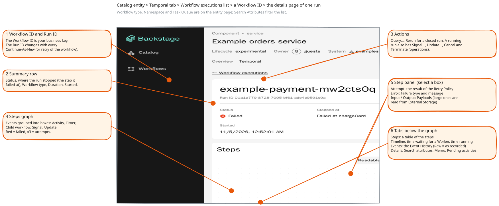

# From Temporal concepts to the plugin

English | [繁體中文](zh-TW/concepts-to-plugin.md)

This guide answers two questions: where does each Temporal concept appear in
the plugin, and what does the plugin add that Temporal does not have? It
assumes the vocabulary of the [Temporal primer](temporal-primer.md). Settings,
permissions and extension APIs are only named here; the
[README](../README.md) has the reference for each.

- [Where to find things on the details page](#where-to-find-things-on-the-details-page)
- [Concept by concept](#concept-by-concept)
- [What the plugin adds](#what-the-plugin-adds)
- [What the plugin does not do](#what-the-plugin-does-not-do)

## Where to find things on the details page

You reach the details page from a catalog entity: open its **Temporal** tab,
which lists **Workflow executions**, then select a Workflow ID.



The numbers mark, in order: the Workflow ID (your business key) and the Run ID
(new for every Continue-As-New); the summary row with the status and the step
the run stopped at; the actions; the step graph; the step panel with attempt,
error, input and output; and the tabs below the graph: **Steps** (a table of the steps),
**Timeline**, **Events** and **Details**. The screenshot shows a run that has closed, so only
**Query…** and **Rerun** are offered; a running workflow also has **Signal…**,
**Update…**, **Cancel** and **Terminate**.

## Concept by concept

"Core" means the core plugin, "control" the optional control modules (see
[Architecture](architecture.md#packages)). The right-hand column names what is
not available.

### Connection and scope

| Temporal concept | In the plugin                                                                                                                                   | Notes                                                                                                                                |
| ---------------- | ----------------------------------------------------------------------------------------------------------------------------------------------- | ------------------------------------------------------------------------------------------------------------------------------------ |
| Namespace        | `temporal.connection.namespaces` and `defaultNamespace`; an entity chooses one with the `temporal.io/namespace` annotation or `spec.namespace`. | The plugin reads namespaces; it never creates or changes one. Requests for a namespace outside the list are rejected.                |
| Authentication   | `temporal.connection.auth` (`none` or `bearer`) and `connection.tls`.                                                                           | The token stays in the backend. Client certificates (mTLS) are not supported yet. See [Authentication](../README.md#authentication). |

### Workflows and executions

| Temporal concept    | In the plugin                                                                                                                                                                                                                                                                 | Notes                                                |
| ------------------- | ----------------------------------------------------------------------------------------------------------------------------------------------------------------------------------------------------------------------------------------------------------------------------- | ---------------------------------------------------- |
| Workflow Type       | The `spec.workflowType` of a `TemporalWorkflow` entity, or the `temporal.io/workflow-type` annotation; the **Workflow type** card and column.                                                                                                                                 |                                                      |
| Workflow Execution  | **Workflow executions** on the entity's Temporal tab (status, times, progress: the current step, or the step it failed at); the **Workflows** page for a whole namespace; the details page.                                                                                   | Filters, page and page size are kept in the URL.     |
| Workflow ID, Run ID | Both in the details header.                                                                                                                                                                                                                                                   |                                                      |
| Workflow Definition | The **Definition** tab, with two optional Zigflow modules for workflows written in YAML (the YAML next to its graph, with a run laid over it) and, for workflows written in code, `spec.definition` with `format: source` shows the source with the workflow function marked. | The code is not parsed beyond locating the function. |

### Steps

| Temporal concept       | In the plugin                                                                                                                                                                                                      | Notes                                                                                                                                                                                     |
| ---------------------- | ------------------------------------------------------------------------------------------------------------------------------------------------------------------------------------------------------------------ | ----------------------------------------------------------------------------------------------------------------------------------------------------------------------------------------- |
| Activity               | A box in the graph, coloured by status, `×3` for attempts; the step panel; the **Steps** table; **Pending activities** on **Details**.                                                                             | Only the last attempt and the failure before it are recorded by Temporal.                                                                                                                 |
| Timer                  | A Timer box (titled `Timer 24h`, subtitle such as `Fires in 23h 59m`) and bar; the step panel has a **Fires** field. With a `…Pending` attribute a wait's timer reads "Waiting for approval" and "Times out in …". |                                                                                                                                                                                           |
| Retry Policy           | The result: attempts on the box, "2 retries" and the waiting time in the timeline.                                                                                                                                 | The policy is not shown or edited; it lives in your code.                                                                                                                                 |
| Child Workflow         | A box that links to the child's details page.                                                                                                                                                                      |                                                                                                                                                                                           |
| Local Activity, Marker | A local activity is a step (a `MarkerRecorded` event named like a local activity).                                                                                                                                 | Other markers (side effects, version markers) are left out of the graph unless you turn on **Show markers** above it (off by default); the Events tab has the same switch, on by default. |

### The record

| Temporal concept | In the plugin                                                                                                                                                                            | Notes                                                                                                                                |
| ---------------- | ---------------------------------------------------------------------------------------------------------------------------------------------------------------------------------------- | ------------------------------------------------------------------------------------------------------------------------------------ |
| Event History    | The **Events** tab (grouped by step, or the raw list); the graph, **Timeline** and **Steps** are computed from it. Workflow task events are hidden by default (**Show workflow tasks**). | The graph reads a bounded number of events; a longer history shows its start and says so ([details](../README.md#workflow-details)). |

### Operations

| Temporal concept  | In the plugin                                                                                                                                    | Notes                                                                                       |
| ----------------- | ------------------------------------------------------------------------------------------------------------------------------------------------ | ------------------------------------------------------------------------------------------- |
| Start             | **Start workflow** on the Temporal tab of `TemporalWorkflow` entities and on the Workflows page; `spec.exampleInput` prefills the input.         | Control modules. The backend starts only the entity's own workflow types on its task queue. |
| Signal            | **Signal…**: a dialog that lists the signal names the workflow declares and takes JSON arguments.                                                | Control modules.                                                                            |
| Query             | **Query…**; it also works on closed workflows.                                                                                                   | Core, with its own permission.                                                              |
| Update            | **Update…**: shows the result or the validator's error message.                                                                                  | Control modules. A rejected update is not in the history, so it is not in the graph.        |
| Cancel, Terminate | Two buttons, both with confirmation; Terminate takes a reason that stays in the history.                                                         | Control modules.                                                                            |
| Reset             | Not available.                                                                                                                                   | Use the Temporal UI or CLI.                                                                 |
| Rerun             | Starts the workflow again with the same input, type, task queue and so on, under a new Workflow ID.                                              | The plugin's own operation.                                                                 |
| Batch operations  | Not available.                                                                                                                                   | Use the Temporal UI or CLI.                                                                 |
| Schedules         | Listed on the Workflows page (default namespace) and on an entity's Temporal tab; **Pause**/**Resume** and **Run now** with the control modules. | Creating and editing schedules is left to code or the Temporal UI.                          |

### Long workflows

| Temporal concept | In the plugin                                                                                                                              | Notes                           |
| ---------------- | ------------------------------------------------------------------------------------------------------------------------------------------ | ------------------------------- |
| Continue-As-New  | `Run 2 of 3` in the header with an explanation, links to the run before and after; the status keeps Temporal's name, **Continued as new**. | **Show all runs** on the lists. |

### Search and data

| Temporal concept        | In the plugin                                                                                                                                                                                       | Notes                                                                               |
| ----------------------- | --------------------------------------------------------------------------------------------------------------------------------------------------------------------------------------------------- | ----------------------------------------------------------------------------------- |
| Search Attributes       | Two optional keyword attributes, named in `temporal.searchAttributes`, record the entity and the initiator; **Details** lists all attributes; `…Pending` attributes become "Waiting for …".         | See below.                                                                          |
| Memo                    | **Details** tab.                                                                                                                                                                                    |                                                                                     |
| Payload, Data Converter | Decoded like the default Data Converter and shown as JSON.                                                                                                                                          | Needs the history permission, because inputs and results may hold personal data.    |
| Codec, Codec Server     | Not available.                                                                                                                                                                                      | An encrypted payload shows only its encoding and size.                              |
| External Storage        | References left by the official S3 driver are read back, checked against their SHA-256 and shown as JSON, a preview or a thumbnail, with a download. Configured with `temporal.externalStorage.s3`. | S3 driver only. See [Large payloads](../README.md#large-payloads-external-storage). |

### Workers and queues

| Temporal concept         | In the plugin                                                                                  | Notes                                          |
| ------------------------ | ---------------------------------------------------------------------------------------------- | ---------------------------------------------- |
| Task Queue               | The entity's `spec.taskQueue` or annotation, used to find its workflows and to start new ones. | No status page for a queue (backlog, pollers). |
| Worker                   | "Waiting for a worker" on an activity that has not started.                                    | No Worker list or health.                      |
| Worker Versioning, Nexus | Not available.                                                                                 |                                                |

### Everything else

| Temporal concept | In the plugin                                                               | Notes                                                                                                                       |
| ---------------- | --------------------------------------------------------------------------- | --------------------------------------------------------------------------------------------------------------------------- |
| Temporal Web UI  | **Open in Temporal UI** on the details page (set `temporal.webUi.baseUrl`). | A quick way to reach whatever the plugin does not do. See [the plugin and the Temporal Web UI](compared-to-temporal-ui.md). |

## What the plugin adds

Some things have no counterpart in Temporal. They exist to connect workflows to
Backstage.

### The `TemporalWorkflow` entity

A catalog kind where **one entity stands for one Workflow Type** and its
definition. It gives a workflow type an owner, a system, dependencies and a place
in the catalog graph. The `temporal.io/v1alpha1` API version is chosen by this
plugin; it is not defined by Temporal. A component that uses a workflow lists it
in the standard `spec.dependsOn`, and the component's Temporal tab then lists
the workflow types it depends on and their executions. The reasons for using
`dependsOn` are in the [README](../README.md#workflow-entities). The catalog
module that provides the kind is optional.

### Annotations

Without any new entity, three annotations on an existing entity make its
workflows appear: `temporal.io/namespace`, `temporal.io/task-queue` and
`temporal.io/workflow-type`. The entity's workflows are those that match the
task queue and one of the workflow types, or that carry the entity's reference in
the configured `entityRef` search attribute. See
[Annotations](../README.md#annotations).

### The Pending search attribute convention

The event history cannot say which signal or update a workflow is waiting for.
So the workflow says it. A search attribute whose name ends in `Pending` and whose
value is true (or a non-empty string) is shown as **Waiting for …**: for example
`ApprovalPending` gives "Waiting for approval". Register the attribute once on the
server:

```sh
temporal operator search-attribute create --name ApprovalPending --type Bool
```

and set it in the workflow when it starts to wait, and clear it afterwards:

```ts
import { defineSearchAttributeKey } from '@temporalio/common';
import { condition, upsertSearchAttributes } from '@temporalio/workflow';

const APPROVAL_PENDING = defineSearchAttributeKey('ApprovalPending', 'BOOL');

export async function releaseWorkflow(input: ReleaseInput) {
  // ... do the work that comes before the approval
  upsertSearchAttributes([{ key: APPROVAL_PENDING, value: true }]);
  const decided = await condition(() => decision !== undefined, '24 hours');
  upsertSearchAttributes([{ key: APPROVAL_PENDING, value: false }]);
  // ... continue according to the decision
}
```

The lists and the graph then show "Waiting for approval" while the workflow
waits. Without such an attribute a running workflow with nothing open shows
"Waiting for an external event (signal or update)". In the example worker,
the client starts `approvalWorkflow` with `ApprovalPending` set to true
(`packages/example-worker/src/index.js`) and the workflow clears it when its wait
ends (`packages/example-worker/src/workflows.js`).

### Permissions and audit

Every request passes the Backstage permission framework, and every operation is
recorded with the auditor. Most permissions are resource permissions on the
catalog entity, so a policy can reuse catalog rules ("only the owners of the
component may terminate"); two list permissions apply to workflows themselves,
with rules of their own. The Temporal history records who acted
(`backstage:user:default/jane`). The permission table, policy examples and
conditions are in [Permissions](../README.md#permissions) and
[Workflow controls](../README.md#workflow-controls). With no policy, or the
allow-all policy, everyone who is signed in can read and operate everything;
write a policy before you enable the plugin for people who should not. How the
checks are layered is in [How it works](how-it-works.md).

### Controls, schedules and templates

The control modules add Start, Signal, Update, Cancel, Terminate and Rerun, and
pause, resume or trigger of schedules ([Workflow controls](../README.md#workflow-controls),
[Schedules](../README.md#schedules)). The Scaffolder modules add the actions
`temporal:workflow:start`, `temporal:workflow:wait` and `temporal:workflow:signal`
(which sends a signal or an update) and the `TemporalWorkflowPicker` field
([Templates](../README.md#templates-scaffolder)). The actions run as the user who
runs the template.

### Message descriptions

A `TemporalWorkflow` entity can describe its signals, updates and queries in
`spec.messages` (a description, an example and a JSON Schema for the argument),
so the dialogs show a form instead of a JSON field. See
[Workflow controls](../README.md#workflow-controls).

### Extension points

You add your own buttons, tabs, list actions, backend actions and data
enrichers without changing the plugin. [Architecture](architecture.md#extension-points)
lists them.

### AI workflows (experimental, off by default)

Loops (generate, check, revise) and LLM agents appear in Temporal only as a long
series of activities. When workers add markers with the experimental
`@kwkevinchan/temporal-workflow-kit` (not published yet), the plugin can fold a
loop into one box with a frame per round, add a **Loops** tab, and draw a model
call with its tool calls and a panel for its prompt, output and token usage. These
views are behind `temporal.experimental.aiWorkflows: true`, are not part of the
first release, will move to a separate package and carry no compatibility
promise. See [Loops](../README.md#loops) and [LLM steps](../README.md#llm-steps).

## What the plugin does not do

- It does not create or change namespaces, search attributes or schedules.
- It does not reset workflows, run batch operations or manage Worker versions.
- It does not decrypt payloads (no Codec Server support).
- It does not show Workers or the state of a task queue.
- It has no database of its own: it asks Temporal each time.

For these, use **Open in Temporal UI**, the Temporal CLI or code.

Next: [How it works](how-it-works.md), or [the walkthrough](walkthrough.md) to
see all of this on your own machine.
