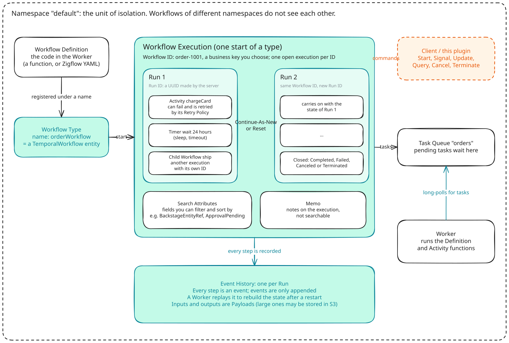
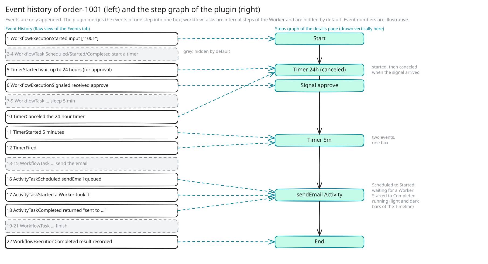

# Temporal primer

English | [繁體中文](zh-TW/temporal-primer.md)

This guide answers one question: what do you need to know about Temporal to
read the plugin's screens? It covers the problem Temporal solves, who talks to
whom, the core concepts, a minimal example, and what an execution looks like
in its event history. It is a summary written for this plugin; the links point
to the official documentation for details and for the numbers that change
between versions.

- [What problem Temporal solves](#what-problem-temporal-solves)
- [Who talks to whom](#who-talks-to-whom)
- [Core concepts](#core-concepts)
- [A minimal example in TypeScript](#a-minimal-example-in-typescript)
- [What an execution looks like in the event history](#what-an-execution-looks-like-in-the-event-history)
- [Further reading](#further-reading)

The next guide, [From Temporal concepts to the plugin](concepts-to-plugin.md),
maps every concept below to a screen or a setting.

## What problem Temporal solves

An ordinary request handler finishes in a moment. Many business processes do
not: they run for days, wait for a person, and fail halfway. Create an order,
reserve stock, wait three days for a manager's approval, deploy, notify. If you
write this yourself you also write the scheduling, the retries, the state in a
database and the logic that resumes after a restart. Temporal does that part;
you write the sequence of steps as ordinary code.

- **Durable execution.** Every step of a workflow is recorded on the server. If
  a worker crashes or is redeployed, the workflow continues where it stopped,
  with its variables intact.
- **Automatic retries.** A call to an external service that fails is retried
  according to a retry policy (interval, number of attempts, errors that are
  not retried). You do not write a retry loop.
- **Long waits.** `await sleep('3 days')`, or waiting for a person, holds no
  thread and no memory while it waits. The workflow continues when the time
  has passed or the message arrives.
- **Visibility.** Every execution has a complete event history: which step,
  when, with which input and output, and why it failed. The plugin draws this
  history.

Official documentation: [What is Temporal?](https://docs.temporal.io/temporal),
[Understanding Temporal](https://docs.temporal.io/evaluate/understanding-temporal),
[Retry Policies](https://docs.temporal.io/encyclopedia/retry-policies),
[Workflow Execution](https://docs.temporal.io/workflow-execution). To learn by
doing, take Temporal 101 at [learn.temporal.io](https://learn.temporal.io/)
(it has a TypeScript version).

## Who talks to whom

The Temporal Service does not run your code. It keeps the books (the event
history) and hands out work (task queues). Your own **Worker** process runs the
code: it polls the service for work, executes it and reports back.

- A **Client** (your application, the Temporal CLI, or this plugin's backend)
  starts workflows and sends messages to them.
- The **Temporal Service** records every step as an event and puts the next
  piece of work on a task queue.
- A **Worker** registers workflow and activity code, long-polls a task queue,
  runs what it receives and reports the result. A Worker opens no port; it
  connects to the service, so it can run anywhere that can reach the service.
  To process more work, run more Workers on the same task queue.

The plugin is a Client that also reads. It connects to the service's frontend
(gRPC) and, for large payloads, to S3. It never talks to a Worker and never
touches Temporal's database.

### Inside the Temporal Service

The service is one binary that runs in four roles, which can be scaled
separately: **Frontend** (the only gRPC entry point; Clients, Workers and this
plugin connect to it), **History** (the state and event history of every
workflow execution, and its timers), **Matching** (task queues; Workers'
long polls wait here) and an internal **Worker** that runs Temporal's own system
workflows. `temporal server start-dev` runs everything in one process with
SQLite, which is what the development setup of this repository uses. See
[Temporal Service](https://docs.temporal.io/temporal-service) and the
[self-hosted guide](https://docs.temporal.io/self-hosted-guide) for production
deployments.

Two stores sit behind it: **persistence** (workflow state and history) and
**visibility** (lists and search). The plugin lists workflows by querying
visibility, so it needs a Temporal server with
[advanced visibility](https://docs.temporal.io/self-hosted-guide/visibility)
(a SQL database that supports it, or Elasticsearch/OpenSearch), and the custom
search attributes named in
[`temporal.searchAttributes`](../README.md#configuration) registered. With
Elasticsearch, a workflow that has just started can take a moment to appear in
a list.

### How a task queue works

A task queue is not something you create in advance; it exists as soon as a
Worker or a Client uses its name. Under one name there are two queues, one for
workflow tasks and one for activity tasks, which Workers poll separately. When
a Worker is waiting, a task is handed over directly; otherwise it waits in the
queue until a Worker arrives. One task goes to one Worker. If no Worker listens,
tasks wait and the workflow does not fail; it just does not advance. The
plugin shows this as "Waiting for a worker" on an activity that is scheduled
but not started.

Workers that have run a workflow keep its state in memory, and the service
prefers to send that workflow's next task to the same Worker (a "sticky"
queue), which avoids replaying the history. See
[Task Queues](https://docs.temporal.io/task-queue) and
[Tasks](https://docs.temporal.io/tasks).

## Core concepts

The terms stay in English because Temporal's documentation, its error messages
and the plugin's screens all use them. Bold text is the label on the plugin's
screen. [From Temporal concepts to the plugin](concepts-to-plugin.md) lists
all of them.



Read it from left to right. Code (a Workflow Definition) is registered under a
name (a Workflow Type). Each start is an execution (a Workflow Execution). The
big box in the middle is one execution: its Workflow ID is a business key you
choose, it can consist of several Runs (a new Run ID after Continue-As-New or
Reset), and each Run holds steps (activities, timers, child workflows) and has
its own event history. Search Attributes and Memo hang on the execution. On
the right, a Client (or the plugin) commands the execution, and a Worker pulls
work from the Task Queue and does it. Orange dashes are the plugin.

### The workflow itself

- **Namespace.** The unit of isolation. Workflows in different namespaces do
  not see each other; retention and access control are set per namespace. The
  plugin reads only the namespaces you list in `temporal.connection.namespaces`
  and never creates or changes one. Screen: the **Namespace** field of the
  **Workflow type** card; "Namespace: default" under the list title.
- **Workflow Definition.** The code that says how the workflow proceeds, an
  async function. It must be replayable: the same history must lead to the same
  decisions, so it must not read the clock, use random numbers or call the
  network directly; those belong in activities. Screen: none in the core
  plugin; workflows written in YAML or code can show a **Definition** tab
  through [another module](concepts-to-plugin.md#what-the-plugin-adds).
- **Workflow Type.** The name of a definition, for example `orderWorkflow`. You
  start a workflow by naming its type. Screen: the **Workflow type** column and
  card.
- **Workflow Execution.** One start of a type, like an object of a class: one
  definition, many executions. Screen: one row of **Workflow executions**; its
  details page.
- **Workflow ID and Run ID.** The Workflow ID is a business key you choose, and
  at most one open execution can have it, which prevents duplicates. The Run ID
  is a UUID made by the server and changes with every Continue-As-New (or retry
  of the whole workflow). Screen: the **Workflow ID** column; the **Run ID** and
  `Run 2 of 3` in the details header.

### Doers and queues

- **Activity.** A step that talks to the outside world: call an API, write to a
  database, send an email, call a model. It can fail, be retried and be slow;
  its result is recorded in the history. Most boxes in the plugin's graph are
  activities. Screen: boxes in the graph, the **Steps** table, **Attempt** in
  the step panel, **Pending activities** on the **Details** tab.
- **Worker.** Your process that registers workflow and activity code and polls
  for work. Screen: none; the plugin has no Worker list, only "Waiting for a
  worker" on an activity that nobody has picked up.
- **Task Queue.** The named waiting area on the server. Screen: the **Task
  queue** field of the list and details.
- **Retry Policy.** How a failed activity is retried: first interval,
  multiplier, maximum attempts, errors that are not retried. By default an
  activity retries without limit, so set a maximum. Screen: `×3` on a box and
  "2 retries" in the timeline; the policy itself is not shown.
- **Timer.** A `sleep()` or the timeout of a wait, kept by the server; the
  Worker does nothing while it runs. Screen: Timer boxes, for example
  "Timer 24h: Timer fires at …".

A retried activity shows as one box. In the timeline its light bar covers the time
in the queue, the failed attempts and the retry backoff, and its solid bar the
attempt that ran last.

### The record

- **Event History.** Every event of a Run, numbered in order, only ever
  appended. It is Temporal's source of truth: a restarted Worker rebuilds a
  workflow's state by replaying it. The graph, the timeline and the **Steps**
  table are all computed from it. Screen: **Events** tab.

### Talking to a running workflow

- **Signal.** A message sent into a workflow without waiting for an answer. The
  workflow receives it in a handler and changes its state. It is recorded in
  the history. Screen: **Signal…** button; Signal steps in the graph.
- **Query.** Reads the current state of a workflow. It changes nothing and is
  not recorded. It also works on a closed workflow, if a Worker is online.
  Screen: **Query…** button.
- **Update.** Like a Signal, but it waits until the workflow has handled it and
  returns a result, and a validator can reject an invalid request before it is
  recorded. Screen: **Update…** button; Update steps in the graph (a rejected
  update is not in the history, so it is not shown).
- **Cancel and Terminate.** Cancel asks the workflow to stop, and it can clean
  up (for example roll back). Terminate ends it at once without running any of
  its code, and takes a reason. Screen: **Cancel** and **Terminate** buttons.
  The plugin adds **Rerun**, which starts a new execution with the same input;
  it is the plugin's own combination of operations, not a Temporal API.

### Long-running workflows

- **Continue-As-New.** The event history of one Run has a size limit (see
  [Event History](https://docs.temporal.io/encyclopedia/event-history)), so a
  workflow that runs long or loops many times continues as a new Run: same
  Workflow ID, new Run ID, an empty history, carrying its state. The plugin
  chains the Runs together. Screen: `Run 2 of 3`, links to the runs before and
  after, and the status **Continued as new**.
- **Child Workflow.** A workflow started by another workflow, with its own ID
  and history; the parent can wait for its result. Screen: a child workflow box
  that links to the child's details page.

### Finding workflows and carrying data

- **Search Attributes.** Fields on an execution that can be searched and
  filtered; their types are registered on the server first. **Memo** holds
  notes that cannot be searched. The plugin uses a search attribute to learn
  which entity a workflow belongs to (`BackstageEntityRef`) and who started it
  (`BackstageInitiator`). Screen: **Search attributes** and **Memo** on the
  **Details** tab. An attribute whose name ends in `Pending` becomes "Waiting
  for …" ([details](concepts-to-plugin.md#the-pending-search-attribute-convention)).
- **Payload and Data Converter.** Inputs, outputs and activity arguments are
  stored as Payloads: metadata (such as `encoding: json/plain`) plus bytes. A
  Data Converter turns objects into Payloads and back. Screen: input and output
  in the step panel, shown as JSON.
- **Codec.** A step after the Data Converter that transforms a whole Payload,
  usually to encrypt or compress it. Once encrypted, neither the server nor any
  UI can read it unless a Codec Server decodes it. Screen: the plugin shows the
  encoding and size of a payload it cannot decode; it does not decrypt.
- **External Storage.** An SDK feature (public preview) that stores payloads
  above a threshold in S3 and keeps a reference in the history. See
  [External Storage](https://docs.temporal.io/external-storage) for the
  thresholds and versions. Screen: the step panel shows the stored content, a
  preview or a thumbnail and lets you download it
  ([setup](../README.md#large-payloads-external-storage)).

## A minimal example in TypeScript

An order workflow: wait for a manager's approval by Signal (at most 24 hours),
wait five minutes, then send an email. The packages are `@temporalio/workflow`,
`@temporalio/activity`, `@temporalio/worker` and `@temporalio/client`.

**activities.ts** (may call the outside world)

```ts
// An activity is an ordinary async function and may do any I/O.
export async function sendEmail(to: string): Promise<string> {
  // Send the email. If it throws, the retry policy decides what happens.
  return `sent to ${to}`;
}
```

**workflows.ts** (must be replayable)

```ts
import {
  proxyActivities,
  defineSignal,
  setHandler,
  condition,
  sleep,
} from '@temporalio/workflow';
import type * as activities from './activities';

const { sendEmail } = proxyActivities<typeof activities>({
  startToCloseTimeout: '1 minute',
  retry: { maximumAttempts: 5 },
});

export const approve = defineSignal<[string]>('approve');

export async function orderWorkflow(orderId: string) {
  let approvedBy: string | undefined;
  setHandler(approve, by => {
    approvedBy = by;
  });

  // A timer: wait at most 24 hours, holding no resources.
  const ok = await condition(() => !!approvedBy, '24 hours');
  if (!ok) return 'timed out';

  await sleep('5 minutes');
  return await sendEmail(`${orderId}@example.com`);
}
```

**worker.ts** (the process you deploy)

```ts
import { NativeConnection, Worker } from '@temporalio/worker';
import * as activities from './activities';

const connection = await NativeConnection.connect({
  address: 'localhost:7233',
});
const worker = await Worker.create({
  connection,
  namespace: 'default',
  taskQueue: 'orders', // the queue this Worker polls
  workflowsPath: require.resolve('./workflows'),
  activities,
});
await worker.run();
```

**client.ts** (start the workflow, send the Signal)

```ts
import { Client, Connection } from '@temporalio/client';
import { orderWorkflow, approve } from './workflows';

const client = new Client({
  connection: await Connection.connect({ address: 'localhost:7233' }),
});
const handle = await client.workflow.start(orderWorkflow, {
  taskQueue: 'orders',
  workflowId: 'order-1001', // business key; prevents duplicates
  args: ['1001'],
});
await handle.signal(approve, 'manager-a');
console.log(await handle.result());
```

To try it locally, run `temporal server start-dev` (a development server with
the Web UI), then the Worker and the Client. The top-level `await` needs ES
modules, or wrap the code in an async function.

## What an execution looks like in the event history

When `order-1001` above has run, its history looks roughly like the left side
of the next figure. The plugin groups the events of each step into one box.



Events are numbered in order and only appended. Workflow tasks (grey) are the
Worker's internal steps of running workflow code; the plugin hides them by
default. Two events (`TimerStarted`, `TimerFired`) make one Timer box, and
`ActivityTaskScheduled`, `Started` and `Completed` make one activity box, whose
time the timeline splits into "waiting for a Worker" (scheduled to started) and
"running" (started to completed). The numbers are illustrative.

Temporal records only the last attempt of an activity and the failure of the
attempt before it. The plugin can therefore show which attempt a step is on and
its latest error, but not every earlier retry.

### Durable execution is replay

Temporal does not save a Worker's memory. It saves the event history above and,
when needed, runs the workflow code again to compute the state.

- **Every step becomes an event.** When workflow code calls an activity, starts
  a timer or waits for a signal, the SDK sends a command to the server, which
  records it.
- **Replay.** After a crash or a deployment, a Worker runs the workflow code
  from the start. Steps that already have events are not done again; the SDK
  returns their recorded results to the code. "The variables are still there"
  means they are computed again.
- **The price is determinism.** Replaying the same history must produce the same
  commands in the same order. Workflow code therefore cannot use random numbers,
  the current time, the network or files directly; those go into activities,
  whose results are recorded. The TypeScript SDK runs workflows in a sandbox that
  replaces `Math.random` and `Date` with replayable versions. If you change the
  order of steps, running executions can no longer replay (a nondeterminism
  error); use patching ([TypeScript versioning](https://docs.temporal.io/develop/typescript/workflows/versioning)).
- **Replay is not constant.** With sticky queues a Worker keeps the state in
  memory and replays only when the state is evicted or another Worker takes over.
- **Long histories** use Continue-As-New (see above); the plugin's **Continued as
  new** status is this.

See [Event History](https://docs.temporal.io/encyclopedia/event-history) and the
deterministic constraints in
[Workflow Definition](https://docs.temporal.io/workflow-definition).

## Further reading

1. [Temporal 101](https://learn.temporal.io/courses/temporal_101/) and
   [Temporal 102](https://learn.temporal.io/courses/temporal_102/): free
   official courses with TypeScript versions. 102 covers durable execution,
   testing and debugging.
2. [Interacting with Workflows](https://learn.temporal.io/courses/interacting_with_workflows/):
   Signals, Queries and Updates, the three message kinds behind the plugin's
   **Signal…**, **Update…** and **Query…** buttons.
3. [How Durable Execution Works](https://temporal.io/blog/building-reliable-distributed-systems-in-node-js-part-2):
   how a Worker replays a history, in TypeScript.
4. [Designing a Workflow Engine from First Principles](https://temporal.io/blog/workflow-engine-principles/):
   how the Temporal Service itself is designed.
5. [awesome-temporal](https://github.com/temporalio/awesome-temporal): more
   material.

Next: [From Temporal concepts to the plugin](concepts-to-plugin.md).
