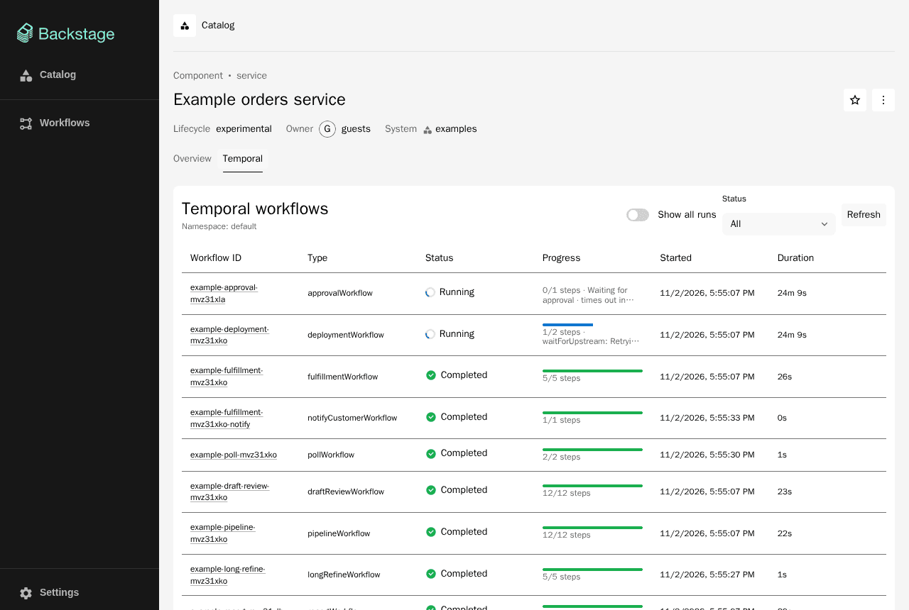
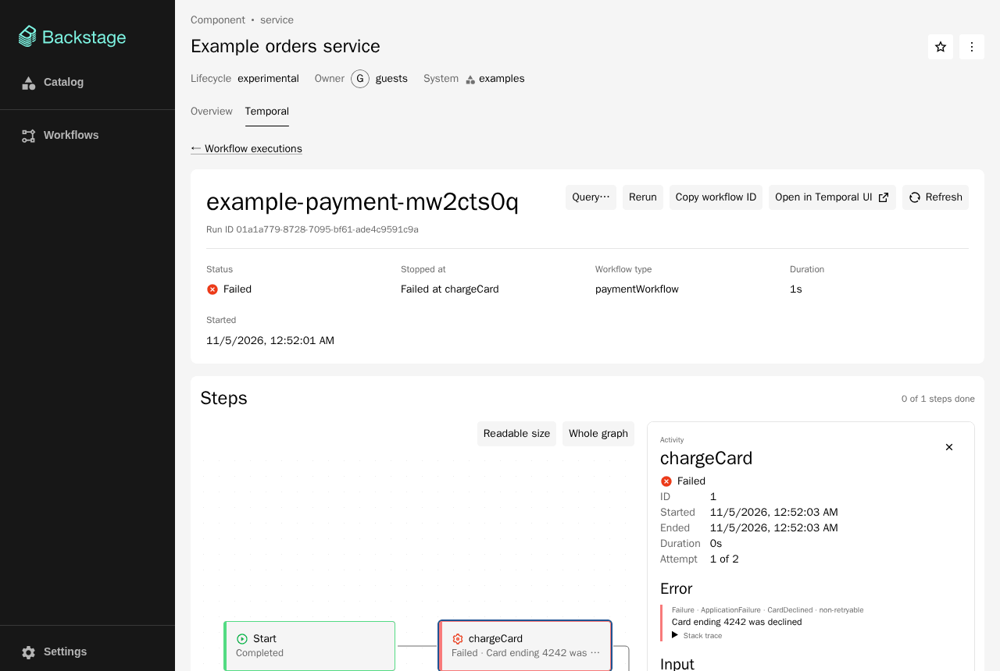
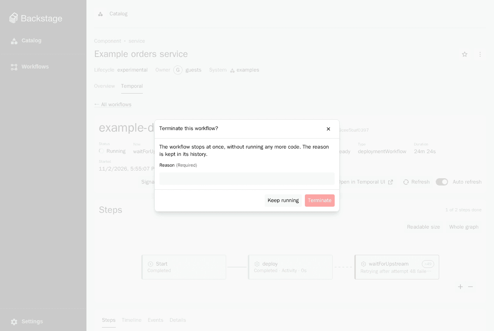
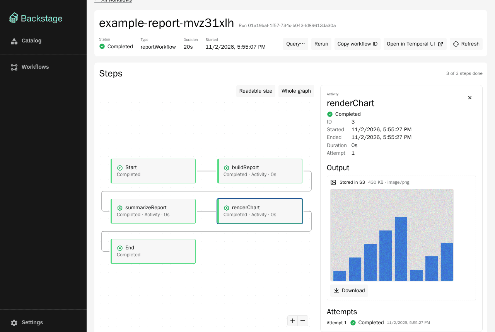
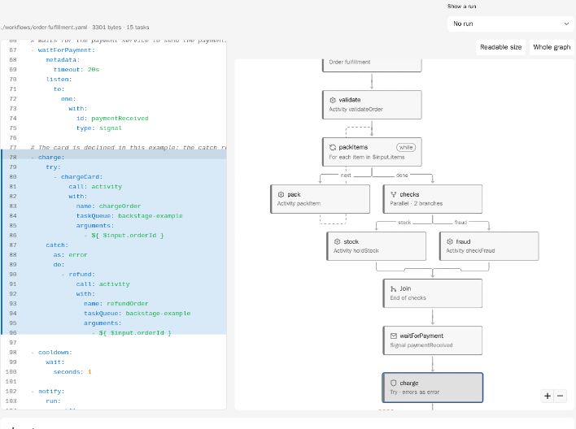
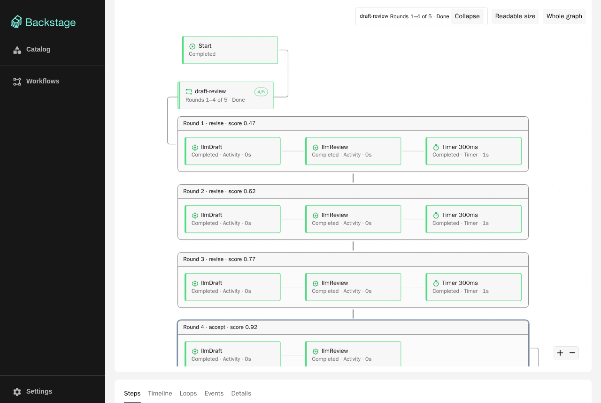
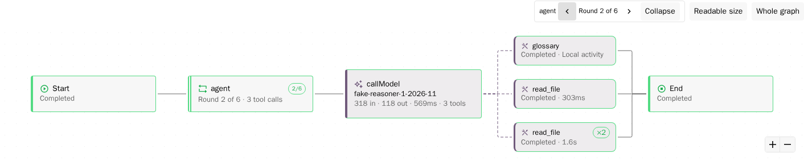

# Walkthrough

English | [繁體中文](zh-TW/walkthrough.md)

This guide takes you through the plugin on your own machine, with the
development app and the example worker of this repository. It answers: what do
the screens show, and what happens when you operate a workflow? Allow about two
hours. You will meet the core Temporal concepts and every screen and operation
of the plugin, and you will know where to look when something is wrong. Each step
says what to look at and why.

Everything here uses only what is in this repository: the development apps
(`packages/app`, `packages/app-next`, `packages/backend`), the example worker
(`packages/example-worker`), the catalog entities in `examples/entities.yaml`
and, optionally, the Docker Compose file in `examples/`. Where a step needs
Docker, it says so and is optional.

- [0. Before you start](#0-before-you-start)
- [1. Start the environment](#1-start-the-environment)
- [2. Find workflows in the catalog](#2-find-workflows-in-the-catalog)
- [3. Read a run](#3-read-a-run)
- [4. Operate running workflows](#4-operate-running-workflows)
- [5. Long workflows, child workflows, large data](#5-long-workflows-child-workflows-large-data)
- [6. Workflow definitions in YAML (optional)](#6-workflow-definitions-in-yaml-optional)
- [7. AI workflows (experimental)](#7-ai-workflows-experimental)
- [8. The Temporal side](#8-the-temporal-side)
- [9. Automated checks and clean-up](#9-automated-checks-and-clean-up)
- [What you should be able to do afterwards](#what-you-should-be-able-to-do-afterwards)

## 0. Before you start

Read, in about 20 minutes, the [Temporal primer](temporal-primer.md) up to
"Core concepts". You only need the difference between Workflow Type, Workflow
Execution, Event History, Activity, Signal, Query and Update; the rest comes from
doing. [From Temporal concepts to the plugin](concepts-to-plugin.md) is the
reference to keep open.

You need Node.js 22 or 24, Yarn 4 through Corepack, and the
[Temporal CLI](https://docs.temporal.io/cli) for a local Temporal server (or
Docker; see the [README's Development section](../README.md#development)). The
whole setup is a Temporal development server, a Backstage backend and frontend,
and a worker; it is light enough for a laptop, but do not run it next to heavy
builds.

## 1. Start the environment

1. Install the dependencies:

   ```sh
   corepack enable
   yarn install
   ```

2. Start a Temporal development server, with the search attributes the plugin and
   the example worker use:

   ```sh
   temporal server start-dev \
     --search-attribute BackstageEntityRef=Keyword \
     --search-attribute BackstageInitiator=Keyword \
     --search-attribute ApprovalPending=Bool
   ```

   It listens on `localhost:7233`, which is what `app-config.yaml` expects. Its
   Web UI is on <http://localhost:8233> by default; the development config links
   to `http://localhost:8080`, so set `TEMPORAL_UI_URL=http://localhost:8233` for
   the next command if you want **Open in Temporal UI** to work.

3. In a second terminal, start the app and the backend (`yarn start:next` starts
   the new frontend system app instead):

   ```sh
   yarn start
   ```

   Open <http://localhost:3000> and sign in as the guest user. The backend is on
   <http://localhost:7007>. The development backend allows every permission (the
   allow-all policy), so every button works.

4. In a third terminal, start the example workflows:

   ```sh
   yarn workspace example-worker start
   ```

   It starts a set of workflows for the `example-orders` component on the
   `backstage-example` task queue (successful, failed, running, with retries, a
   timer, a child workflow, a loop and so on), and prints the workflow IDs. They
   look like `example-order-<suffix>`; the suffix is the start time in base 36.
   This worker stops when the order, payment and fulfillment workflows have
   closed; the deployment and approval workflows stay open.

5. Signals, updates, queries and workflows started from Backstage need a worker
   that keeps polling. Keep this running in the third terminal (or a fourth) until
   you finish:

   ```sh
   yarn workspace example-worker serve
   ```

**What to look at:** the IDs printed in step 4. The next steps use them.

**Why:** the plugin only reads Temporal and sends it commands. It does not run
workflow code; the worker does. Without a worker, workflows do not advance and
operations that need a handler (update, query) time out.

## 2. Find workflows in the catalog

1. In Backstage, open **Catalog**. You will see components such as
   `example-orders`, `example-checkout` and `example-website`, a resource
   `example-order-jobs`, and, with the kind filter set to **TemporalWorkflow**, the
   workflow entities: `example-order-workflow`, `example-payment-workflow`,
   `example-ticket-workflow` and two YAML ones. One entity is one Workflow Type.
2. Open `example-order-workflow`. The **Workflow type** card shows the workflow
   type, task queue and namespace, and has an **Open in Temporal UI** link.
3. Open `example-checkout`. It lists `example-order-workflow` and
   `example-payment-workflow` in `spec.dependsOn`, so its **Temporal** tab shows a
   **Workflow types** card and the executions of both, as well as those matched by
   its own annotations.
4. Compare with `example-website`, which has no Temporal annotations and no
   dependency: it has no **Temporal** tab at all. `example-order-jobs` is a
   `Resource`, not a component, and still has the tab with only the order
   workflows: the plugin does not depend on the entity kind.

**Why:** the plugin finds "the workflows of this entity" from a `TemporalWorkflow`
entity or from `temporal.io/*` annotations. Open `examples/entities.yaml` next to
the UI to see the YAML behind each of these.
See [concepts](concepts-to-plugin.md#what-the-plugin-adds).

## 3. Read a run

Open `example-orders` and its **Temporal** tab. It lists **Workflow executions**.



1. **The list.** Look at the status (Completed, Failed, Running), the times and the
   progress column: the current step, or the step where it failed. Try the status
   filter and **Show all runs**; the URL changes with them, so the browser's back
   button returns to the same page.
2. **A failed run.** Open `example-payment-…`. The header shows the Workflow ID,
   the Run ID, the status and where it stopped (`Failed at chargeCard`). In the
   **Steps** graph the failed box is red; select it to see, in the panel on the
   right, the error (the failure type and message, `Card ending 4242 was declined`,
   and its cause chain), the attempt, input and output.

   

3. **Retries, parallel steps, a timer, a child.** Open `example-fulfillment-…`.
   Two activities run in parallel, so the graph has two branches. The courier step
   shows `×3`: it failed twice and succeeded on the third attempt. A Timer box
   follows (the worker sleeps for two seconds), then a child workflow box.
4. **Timeline.** On the same run, open the **Timeline** tab. Each activity has a
   light bar (waiting for a worker, including earlier attempts and the retry
   backoff) and a solid bar (the run that completed). Hover for times; drag across
   the chart to zoom.
5. **Events.** The **Grouped** view collapses the events of each step; **Raw** is
   the Event History as recorded (`WorkflowExecutionStarted`,
   `WorkflowTaskScheduled`, `ActivityTaskScheduled`, …). Turn on **Show workflow
   tasks** to see the internal events that are hidden by default.
6. **Details.** Look at the search attributes (`BackstageEntityRef` is how the
   plugin finds the workflow's entity), the memo and, for a running workflow,
   **Pending activities**. `example-deployment-…` has an activity that keeps
   retrying.
7. **Compare.** Press **Open in Temporal UI** to see the same run in the Temporal
   Web UI.

**Why:** every screen is computed from one Event History. If you can match the raw
events to the boxes, you understand
[the event history and replay](temporal-primer.md#what-an-execution-looks-like-in-the-event-history).

## 4. Operate running workflows

These steps need the worker from step 1.5 and use the control modules, which the
development apps install.

The page of a running workflow reloads every ten seconds while its browser tab is in
front; the **Auto refresh** switch turns that off. The **Refresh** button stays
locked until its reload has ended and at least a second has passed, so pressing it
repeatedly sends one request.

1. **A workflow that waits for approval.** Open `example-approval-…` (status
   Running). The progress column says **Waiting for approval**: the workflow set
   the search attribute `ApprovalPending` to true, and the plugin turns it into
   this text ([details](concepts-to-plugin.md#the-pending-search-attribute-convention)).
   - Press **Signal…** and send `comment` with the argument `"looks fine"`. The
     workflow records it, and the graph shows a Signal step.
   - Press **Update…**, choose `approve` and send `""`. The workflow's validator
     rejects it (`approver is required`); the dialog shows the message, and the
     rejected update leaves **no** trace in the event history.
   - Send `approve` with `"alice"`. The dialog shows the result
     (`{"approvedBy":"alice"}`), the graph gains an Update step, and the workflow
     completes.
2. **A support ticket.** Open the `example-ticket-workflow` entity, its **Temporal**
   tab, and press **Start workflow**. The input is prefilled from the entity's
   `spec.exampleInput`. Open the run that starts.
   - **Signal…** `addNote`: the dialog shows a form from the entity's input
     schema.
   - **Query…** `state`: you see the note. A query changes nothing and leaves
     nothing in the history.
   - **Update…** `setPriority` with `"high"` returns the previous and new
     priority; with `"urgent"` the validator rejects it (`priority must be one
of low, normal, high`).
   - The **Escalate** button comes from a custom action registered in the
     development backend (`packages/backend/src/escalateAction.ts`); see
     [Extension points](architecture.md#extension-points). It sets the priority
     to high.
   - Send the `close` signal: the workflow completes.
3. **Cancel and Terminate.** Start two more tickets with **Start workflow** (they
   run until closed). Press **Cancel** on one: the workflow gets the chance to
   react; this one just ends, as **Canceled**. Press **Terminate** on the other:
   a reason is required, and it appears in the closing event of the history.
4. **Rerun.** Open a closed run and press **Rerun**: a new workflow starts with the
   same input, type and task queue under a new Workflow ID, and opens.
5. **Who did it.** In the Temporal Web UI, the events of these operations show the
   identity `backstage:user:default/guest`.



**Why:** Signal, Update, Cancel and Terminate are written to the event history;
Query is not. In production you write a permission policy, because the
development backend allows everything; see
[Permissions](../README.md#permissions) and
[How it works](how-it-works.md#figure-1-one-request-through-the-layers).

## 5. Long workflows, child workflows, large data

1. **Continue-As-New.** The example worker starts `pollWorkflow`, which continues
   as new three times. Open its last run: the header says `Run 4 of 4` with an ⓘ
   that explains it, and links such as **← Run 3** move between the runs. The
   earlier runs have the status **Continued as new**.
2. **Child workflows.** In `example-fulfillment-…`, select the child workflow box
   (`notifyCustomerWorkflow`) to open the child's own details page.
3. **Large payloads (optional, needs Docker).** Temporal can store large payloads
   in S3 and keep only a reference in the history. The README's
   [Development section](../README.md#development) has the commands: start RustFS
   with `docker compose -f examples/docker-compose.rustfs.yaml up -d`, start the
   backend with `app-config.s3.yaml` and the worker with the `PAYLOAD_S3_*`
   variables. The worker then also runs `reportWorkflow`. Select its activities:
   the panel shows the stored JSON or a preview, and an image as a thumbnail, with
   a download button; the plugin read the object from S3 and checked its SHA-256.

   

**Why:** the event history has a size limit, so long workflows continue as new and
big payloads go outside. See the primer's
[long-running workflows](temporal-primer.md#long-running-workflows).

## 6. Workflow definitions in YAML (optional)

The YAML examples run in [Zigflow](https://github.com/zigflow/zigflow), which needs
Docker. Follow the README's [Development section](../README.md#development) to
start the Zigflow container and run `yarn workspace example-worker zigflow`. Then
open the `example-yaml-order-workflow` entity and its **Definition** tab:

1. The YAML (`examples/workflows/order-fulfillment.yaml`) is on the left, its
   graph on the right. Select a box and its lines are marked and scrolled to;
   select a line and the innermost task is selected.
2. **Show a run** lays a run over the graph: each box takes the colour of what
   happened, and **Open the run** goes to its details page.
3. Compare with `example-order-workflow`, written in code: its Definition tab links
   to the source from its annotations.



The tab belongs to two optional packages; see
[Workflow definitions](../README.md#workflow-definitions).

## 7. AI workflows (experimental)

The development app turns on `temporal.experimental.aiWorkflows`; the views are
off by default in your own app, will move to a separate package, and carry no
compatibility promise. The example worker starts fake AI workflows that call no
model.

1. **Loops.** `draftReviewWorkflow` drafts, reviews and revises until the score is
   high enough (done in round 4 of 5). The graph folds the loop into one box;
   expand it to see one frame per round. The **Loops** tab lists each round with
   its decision and score. `longRefineWorkflow` runs 25 rounds and continues as new
   every 10, so its rounds are counted across three runs.

   

2. **LLM steps.** In `example-agent-…`, each model call is a box with its tools
   hanging off it, and one tool fails and retries. Select a model call: the panel
   shows the input, the thinking, the output, the tool calls and the usage.
   `mixedAgentWorkflow` mixes ordinary activities, model calls, parallel tools and
   a child workflow.

   

**Why:** Temporal only sees a series of activities. These markers are written by
the workflow kit and read back by the plugin. See [Loops](../README.md#loops) and
[LLM steps](../README.md#llm-steps).

## 8. The Temporal side

With the CLI (the same server, `localhost:7233`):

```sh
temporal workflow list
temporal workflow list --query "BackstageEntityRef='component:default/example-orders'"
temporal workflow show --workflow-id <a workflow ID from step 1>
```

The list the plugin shows for a component is the same visibility query; and the
events of `workflow show` match the **Raw** events one to one.

## 9. Automated checks and clean-up

The repository's Playwright smoke tests walk many of these screens and save a
screenshot of each step (`yarn test:e2e`, or `yarn test:e2e:next` for the new
frontend system app; see the README's
[Development section](../README.md#development)). They need
`npx playwright install chromium`.

To clean up, stop each process with Ctrl+C. If you started them, stop the Zigflow
container and the RustFS compose project (`docker compose -f
examples/docker-compose.rustfs.yaml down`). A development Temporal server keeps
its data in memory unless you gave it a database file, so stopping it forgets the
workflows.

## What you should be able to do afterwards

- [ ] Say how Workflow Type, Workflow Execution and Run ID differ and point at
      each on a screen.
- [ ] Find the failed step, its error and its attempts in the graph.
- [ ] Find the scheduled, started and completed events of one activity in the raw
      events.
- [ ] Send a signal, a query and an update, and say which of them are recorded in
      the history.
- [ ] Explain the difference between Cancel and Terminate.
- [ ] Move between the runs of a Continue-As-New chain and open a child workflow.
- [ ] Explain why a workflow shows **Waiting for approval**.
- [ ] Find the same workflows with the Temporal CLI.

Back to [the documentation index](README.md).
