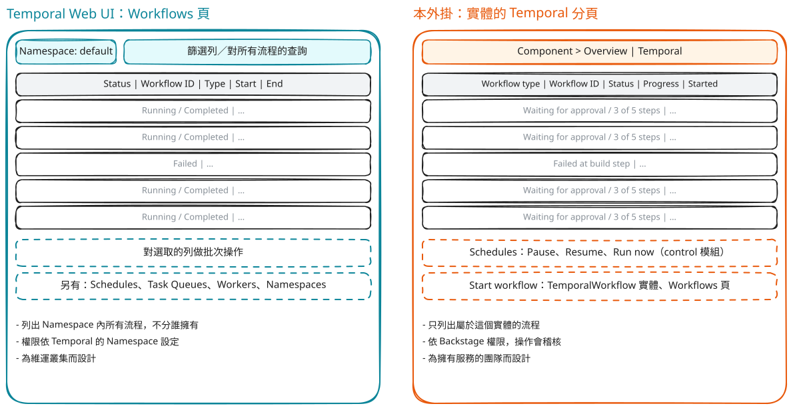
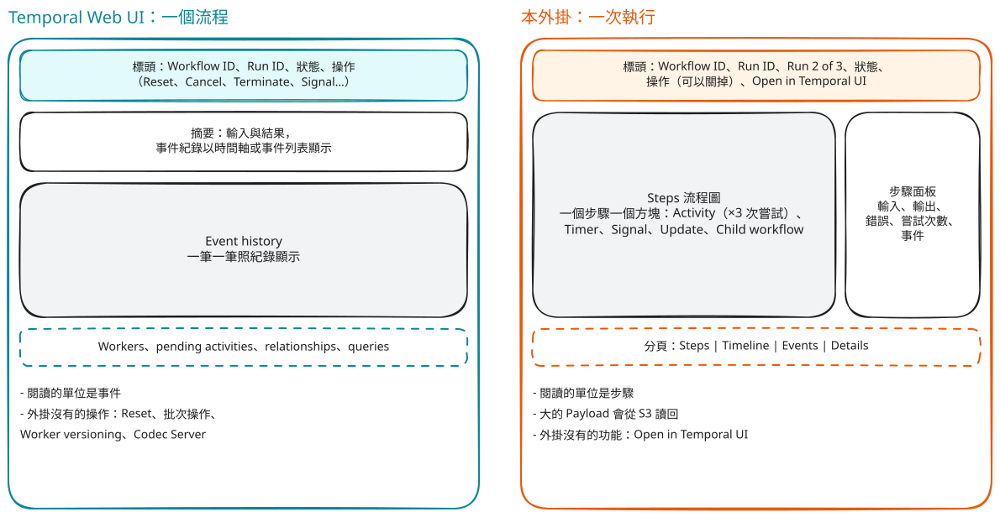

# 外掛和 Temporal Web UI

[English](../compared-to-temporal-ui.md) | 繁體中文

這篇回答：還需要 Temporal Web UI 嗎？什麼事該用哪一個？兩者不是互相取代。Temporal Web UI 是給維運人員看整個叢集的工具；外掛是讓開發團隊在 Backstage 裡，就在自己的元件旁邊看到並操作自己的流程。外掛沒做的事，詳細頁有 **Open in Temporal UI** 連結可以跳過去（設定 `temporal.webUi.baseUrl`）。

下面兩張圖是示意圖，不是任何一個產品的截圖。版面呈現的是兩個工具各自把什麼放在最前面；標籤寫的是功能名稱，不是確切的畫面，不同版本的 Temporal UI 畫面會不同。

## 流程清單

左邊：Temporal Web UI 列出一個 Namespace 的所有流程，有查詢列，周圍是叢集的其他區域。右邊：外掛列出屬於目前這個實體的流程，多一個進度欄（目前的步驟，或失敗的步驟），並提供你的政策允許的操作。你有權列出所有流程時，**Workflows** 頁會列出整個 Namespace。

## 單一流程

左邊：Temporal Web UI 一個事件一個事件地顯示事件紀錄。右邊：外掛把步驟畫成流程圖，選一個方塊就開啟有輸入、輸出、錯誤和嘗試次數的面板；時間軸和原始事件是分頁。事件紀錄是同一份，外掛把它分組成步驟。

## 逐項對照

Temporal Web UI 提供哪些功能取決於它的版本，請看 [Temporal 文件](https://docs.temporal.io/web-ui)。

|                    | Temporal Web UI                                                               | 本外掛                                                                                    |
| ------------------ | ----------------------------------------------------------------------------- | ----------------------------------------------------------------------------------------- |
| 從哪裡進去         | 選一個 Namespace，搜尋所有流程                                                | 從 Backstage 的元件或 `TemporalWorkflow` 實體進去，只看屬於它的；Workflows 頁看其餘的     |
| 誰能看、誰能做什麼 | 依 Temporal 的 Namespace 權限                                                 | 依 Backstage 權限，可以細到「只有元件的 owner 能 Terminate」；操作會稽核並記在使用者名下  |
| 主畫面             | 事件紀錄和時間軸                                                              | 步驟流程圖；選一個方塊看輸入和輸出。時間軸和事件是分頁                                    |
| 操作               | Start、Signal、Cancel、Terminate、Reset、批次操作、Schedule 等                | Start、Signal、Update、Query、Cancel、Terminate、Rerun，以及暫停、恢復、立即執行 Schedule |
| 叢集區域           | Namespace、Task Queue、Worker、Worker Versioning、Codec Server、建立 Schedule | 沒有；用 **Open in Temporal UI**                                                          |
| 大型資料           | 顯示 External Storage 的參照                                                  | 從 S3 讀回物件並顯示內容、預覽或縮圖，可下載                                              |
| AI 流程（實驗性）  | 一長串 Activity                                                               | 迴圈收成一輪一輪，每次模型呼叫有專屬面板                                                  |
| Catalog 脈絡       | 沒有                                                                          | 流程旁邊就是 owner、系統、相依關係和 catalog 圖                                           |

## 什麼時候用哪一個

- **用外掛**：回答「我的服務的流程現在怎樣了？」；讓人不需要 Temporal 的存取權也能啟動或推動一個流程；以及權限和稽核紀錄必須遵守 Backstage 規則的時候。
- **用 Temporal Web UI**（或 CLI）：Reset 流程、批次操作、建立或編輯 Schedule、查看 Worker 和 Task Queue，以及需要看叢集裡所有流程、不論誰擁有的時候。
- **兩個一起用**：除錯時先在外掛打開一次執行，再用 **Open in Temporal UI** 到同一筆執行，看外掛沒顯示的部分。

回到[文件索引](README.md)。
