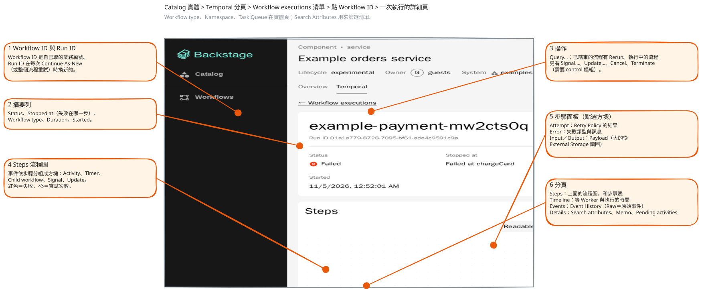

# 從 Temporal 概念到外掛

[English](../concepts-to-plugin.md) | 繁體中文

這篇回答兩個問題：每個 Temporal 概念在外掛的哪裡出現？外掛又加了哪些 Temporal 沒有的東西？內容以[Temporal 入門](temporal-primer.md)的名詞為前提。設定、權限和擴充 API 這裡只點名，各自的參考內容在 [README](../../README.md)（英文）。

- [詳細頁上的位置](#詳細頁上的位置)
- [逐個概念對照](#逐個概念對照)
- [外掛自己加的東西](#外掛自己加的東西)
- [外掛不做的事](#外掛不做的事)

## 詳細頁上的位置

詳細頁從 catalog 實體進去：打開實體的 **Temporal** 分頁，裡面列著 **Workflow executions**，點一個 Workflow ID 就到了。



編號依序標出：Workflow ID（你的業務編號）和 Run ID（每次 Continue-As-New 都換新的）；有狀態和停在哪一步的摘要列；操作；步驟流程圖；有 attempt、error、input、output 的步驟面板；以及圖下方的分頁：**Steps**（步驟表）、**Timeline**、**Events**、**Details**。截圖是一個已結束的執行，所以只有 **Query…** 和 **Rerun**；執行中的流程還有 **Signal…**、**Update…**、**Cancel**、**Terminate**。

## 逐個概念對照

「操作」指改動流程的各項操作：預設開著，設 `temporal.control.enabled: false` 就對所有人關掉（見 [Workflow controls](../../README.md#workflow-controls)）。最右欄寫明哪些功能沒有。

### 連線與範圍

| Temporal 概念  | 外掛裡的對應                                                                                                          | 備註                                                                                              |
| -------------- | --------------------------------------------------------------------------------------------------------------------- | ------------------------------------------------------------------------------------------------- |
| Namespace      | `temporal.connection.namespaces` 和 `defaultNamespace`；實體用 `temporal.io/namespace` 標註或 `spec.namespace` 指定。 | 外掛只讀取 Namespace，不建立或修改。請求清單以外的 Namespace 會被拒絕。                           |
| Authentication | `temporal.connection.auth`（`none` 或 `bearer`）和 `connection.tls`。                                                 | 權杖只留在後端。尚不支援用戶端憑證（mTLS）。見 [Authentication](../../README.md#authentication)。 |

### 流程與執行

| Temporal 概念       | 外掛裡的對應                                                                                                                                                                                        | 備註                                     |
| ------------------- | --------------------------------------------------------------------------------------------------------------------------------------------------------------------------------------------------- | ---------------------------------------- |
| Workflow Type       | `TemporalWorkflow` 實體的 `spec.workflowType`，或 `temporal.io/workflow-type` 標註；**Workflow type** 卡片和欄位。                                                                                  |                                          |
| Workflow Execution  | 實體 Temporal 分頁的 **Workflow executions**（狀態、時間、進度：目前在哪一步，或失敗在哪一步）；整個 Namespace 的 **Workflows** 頁；詳細頁。                                                        | 篩選、頁碼、每頁筆數都留在網址裡。       |
| Workflow ID、Run ID | 都在詳細頁標頭。                                                                                                                                                                                    |                                          |
| Workflow Definition | **Definition** 分頁：兩個選用的 Zigflow 模組支援用 YAML 寫的流程（YAML 和流程圖並排，可以疊上一次執行）；用程式碼寫的流程，在 `spec.definition` 設 `format: source`，就會顯示原始碼並標出流程函式。 | 程式碼不會被解析，只找出流程函式的位置。 |

### 步驟

| Temporal 概念          | 外掛裡的對應                                                                                                                                                                         | 備註                                                                                                                                              |
| ---------------------- | ------------------------------------------------------------------------------------------------------------------------------------------------------------------------------------ | ------------------------------------------------------------------------------------------------------------------------------------------------- |
| Activity               | 流程圖上的方塊，顏色依狀態，嘗試次數標 `×3`；步驟面板；**Steps** 表；**Details** 的 **Pending activities**。                                                                         | Temporal 只記錄最後一次嘗試和前一次的失敗。                                                                                                       |
| Timer                  | Timer 方塊（標題 `Timer 24h`，副標題如 `Fires in 23h 59m`）和長條；步驟面板有 **Fires** 欄位。有 `…Pending` 屬性時，等待的 Timer 會顯示 "Waiting for approval" 和 "Times out in …"。 |                                                                                                                                                   |
| Retry Policy           | 顯示結果：方塊上的嘗試次數、時間軸的 "2 retries" 和等待時間。                                                                                                                        | 不顯示也不編輯策略，策略寫在你的程式碼裡。                                                                                                        |
| Child Workflow         | 方塊，連到子流程的詳細頁。                                                                                                                                                           |                                                                                                                                                   |
| Local Activity、Marker | Local Activity 是一個步驟（名稱像 local activity 的 `MarkerRecorded` 事件）。                                                                                                        | 其他 Marker（side effect、版本標記）預設不畫在流程圖上，可以用圖上方的 **Show markers** 開關顯示（預設關閉）；Events 分頁有同樣的開關，預設開啟。 |

### 紀錄

| Temporal 概念 | 外掛裡的對應                                                                                                                                     | 備註                                                                                               |
| ------------- | ------------------------------------------------------------------------------------------------------------------------------------------------ | -------------------------------------------------------------------------------------------------- |
| Event History | **Events** 分頁（依步驟分組，或原始清單）；流程圖、**Timeline**、**Steps** 都從它算出來。Workflow Task 事件預設隱藏（**Show workflow tasks**）。 | 流程圖只讀有限數量的事件；更長的紀錄會顯示開頭並說明（[細節](../../README.md#workflow-details)）。 |

### 操作

| Temporal 概念     | 外掛裡的對應                                                                                                    | 備註                                                                                   |
| ----------------- | --------------------------------------------------------------------------------------------------------------- | -------------------------------------------------------------------------------------- |
| Start             | `TemporalWorkflow` 實體的 Temporal 分頁和 Workflows 頁的 **Start workflow**；`spec.exampleInput` 預填輸入。     | 操作（`temporal.control.enabled`）。後端只啟動實體自己的流程類型和它的 Task Queue。    |
| Signal            | **Signal…**：對話框列出流程宣告的 Signal 名稱，參數填 JSON。                                                    | 操作（`temporal.control.enabled`）。                                                   |
| Query             | **Query…**；流程結束後也能查。                                                                                  | 一定可用，有自己的權限。                                                               |
| Update            | **Update…**：顯示回傳值或 validator 的錯誤訊息。                                                                | 操作（`temporal.control.enabled`）。被拒絕的 Update 不在事件紀錄裡，所以流程圖上沒有。 |
| Cancel、Terminate | 兩個按鈕，都要確認；Terminate 要填原因，原因留在事件紀錄。                                                      | 操作（`temporal.control.enabled`）。                                                   |
| Reset             | 沒有。                                                                                                          | 用 Temporal UI 或 CLI。                                                                |
| Rerun             | 用相同的輸入、類型、Task Queue 等，以新的 Workflow ID 再啟動一次。                                              | 外掛自己的操作。                                                                       |
| Batch operations  | 沒有。                                                                                                          | 用 Temporal UI 或 CLI。                                                                |
| Schedules         | 列在 Workflows 頁（預設 Namespace）和實體的 Temporal 分頁；也有 **Pause**／**Resume** 和 **Run now** 這些操作。 | 建立和修改 Schedule 留給程式碼或 Temporal UI。                                         |

### 長流程

| Temporal 概念   | 外掛裡的對應                                                                                           | 備註                       |
| --------------- | ------------------------------------------------------------------------------------------------------ | -------------------------- |
| Continue-As-New | 標頭的 `Run 2 of 3` 和說明、前一個和下一個 Run 的連結；狀態保留 Temporal 的名稱 **Continued as new**。 | 清單有 **Show all runs**。 |

### 搜尋與資料

| Temporal 概念           | 外掛裡的對應                                                                                                                                       | 備註                                                                                   |
| ----------------------- | -------------------------------------------------------------------------------------------------------------------------------------------------- | -------------------------------------------------------------------------------------- |
| Search Attributes       | 兩個選用的 Keyword 屬性（名稱寫在 `temporal.searchAttributes`）記錄實體和啟動者；**Details** 列出全部屬性；`…Pending` 屬性會變成 "Waiting for …"。 | 見下文。                                                                               |
| Memo                    | **Details** 分頁。                                                                                                                                 |                                                                                        |
| Payload、Data Converter | 照預設 Data Converter 的方式解碼，以 JSON 顯示。                                                                                                   | 需要 history 權限，因為輸入和結果可能含個人資料。                                      |
| Codec、Codec Server     | 沒有。                                                                                                                                             | 加密過的 Payload 只顯示編碼和大小。                                                    |
| External Storage        | 認得官方 S3 驅動留下的參照：從 S3 取回、比對 SHA-256，以 JSON、預覽或縮圖顯示，可下載。用 `temporal.externalStorage.s3` 設定。                     | 只支援 S3 驅動。見 [Large payloads](../../README.md#large-payloads-external-storage)。 |

### Worker 與佇列

| Temporal 概念            | 外掛裡的對應                                             | 備註                               |
| ------------------------ | -------------------------------------------------------- | ---------------------------------- |
| Task Queue               | 實體的 `spec.taskQueue` 或標註，用來找流程和啟動新流程。 | 沒有佇列的狀態頁（積壓、輪詢者）。 |
| Worker                   | Activity 還沒開始時顯示 "Waiting for a worker"。         | 沒有 Worker 清單或健康狀態。       |
| Worker Versioning、Nexus | 沒有。                                                   |                                    |

### 其他

| Temporal 概念   | 外掛裡的對應                                                        | 備註                                                                                 |
| --------------- | ------------------------------------------------------------------- | ------------------------------------------------------------------------------------ |
| Temporal Web UI | 詳細頁的 **Open in Temporal UI**（設定 `temporal.webUi.baseUrl`）。 | 外掛沒做的事可以一鍵跳過去。見[外掛和 Temporal Web UI](compared-to-temporal-ui.md)。 |

## 外掛自己加的東西

有些東西在 Temporal 裡沒有對應，是為了把流程接進 Backstage 才加的。

### `TemporalWorkflow` 實體

catalog 裡的一個 kind，**一個實體代表一個 Workflow Type** 和它的定義。有了它，流程類型就有 owner、所屬系統、相依關係，也出現在 catalog 關係圖裡。`temporal.io/v1alpha1` 這個 API 版本是這個外掛自己訂的，不是 Temporal 定義的。使用某個流程的元件，用標準的 `spec.dependsOn` 列出它，元件的 Temporal 分頁就會列出它相依的流程類型和它們的執行。為什麼用 `dependsOn`，見 [README](../../README.md#workflow-entities)。後端外掛的預設匯出就帶這個 kind（`catalogModuleTemporalWorkflowKind`）。

### 標註（annotations）

不新增任何實體，也可以在既有實體上加三個標註，讓它的流程出現：`temporal.io/namespace`、`temporal.io/task-queue`、`temporal.io/workflow-type`。實體的流程是符合 Task Queue 而且是其中一種流程類型的執行，或在設定的 `entityRef` Search Attribute 裡帶著這個實體參照的執行。見 [Annotations](../../README.md#annotations)。

### Pending Search Attribute 的約定

事件紀錄說不出流程在等哪個 Signal 或 Update，所以讓流程自己說。名稱以 `Pending` 結尾、值為 true（或非空字串）的 Search Attribute，會顯示成 **Waiting for …**：例如 `ApprovalPending` 顯示 "Waiting for approval"。先在伺服器上註冊這個屬性（只要一次）：

```sh
temporal operator search-attribute create --name ApprovalPending --type Bool
```

流程開始等待時設成 true，之後清掉：

```ts
import { defineSearchAttributeKey } from '@temporalio/common';
import { condition, upsertSearchAttributes } from '@temporalio/workflow';

const APPROVAL_PENDING = defineSearchAttributeKey('ApprovalPending', 'BOOL');

export async function releaseWorkflow(input: ReleaseInput) {
  // ... 做完簽核之前的工作
  upsertSearchAttributes([{ key: APPROVAL_PENDING, value: true }]);
  const decided = await condition(() => decision !== undefined, '24 hours');
  upsertSearchAttributes([{ key: APPROVAL_PENDING, value: false }]);
  // ... 依決定繼續
}
```

流程等待時，清單和流程圖就會顯示 "Waiting for approval"。沒有這種屬性的話，執行中而沒有任何開啟步驟的流程會顯示 "Waiting for an external event (signal or update)"。範例 Worker 裡，由 client 啟動 `approvalWorkflow` 時就帶上 `ApprovalPending` 為 true（`packages/example-worker/src/index.js`），流程在等待結束時把它清掉（`packages/example-worker/src/workflows.js`）。

### 權限與稽核

每個請求都經過 Backstage 權限框架，每個操作都記進 auditor。大部分權限是掛在 catalog 實體上的資源權限，所以政策可以重用 catalog 的規則（「只有元件的 owner 能 Terminate」）；另外兩個 list 權限是針對流程本身，有自己的規則。Temporal 的事件紀錄會記下是誰操作的（`backstage:user:default/jane`）。權限表、政策範例和條件都在 [Permissions](../../README.md#permissions) 和 [Workflow controls](../../README.md#workflow-controls)。沒有政策、或用 allow-all 政策時，登入的人什麼都能看、什麼都能做；要給不該有這些權限的人使用前，請先寫政策。檢查怎麼分層，見[運作方式](how-it-works.md)。

### 操作、Schedule 與範本

操作有 Start、Signal、Update、Cancel、Terminate、Rerun，以及 Schedule 的暫停、恢復、立即執行（[Workflow controls](../../README.md#workflow-controls)、[Schedules](../../README.md#schedules)）。Scaffolder 模組加上 `temporal:workflow:start`、`temporal:workflow:wait`、`temporal:workflow:signal`（送 Signal 或 Update）三個 action，以及 `TemporalWorkflowPicker` 欄位（[Templates](../../README.md#templates-scaffolder)）。這些 action 以執行範本的使用者的身分執行。

### 訊息說明

`TemporalWorkflow` 實體可以在 `spec.messages` 描述流程的 Signal、Update 和 Query（說明、範例，以及參數的 JSON Schema），讓對話框顯示表單而不是 JSON 欄位。見 [Workflow controls](../../README.md#workflow-controls)。

### 擴充點

不用改外掛，就能加自己的按鈕、分頁、清單操作、後端 action 和資料補充。[架構](architecture.md#擴充點)列出了全部。

### AI 流程（實驗性，預設關閉）

迴圈（產生、檢查、修改）和 LLM agent 在 Temporal 裡只是一長串 Activity。外掛會把 Temporal 官方 AI 整合的模型呼叫畫成方塊、工具掛在旁邊，還有顯示 prompt、輸出和 token 用量的面板，不需要任何設定。當 Worker 用實驗性的 `@kwkevinchan/temporal-workflow-kit`（尚未發佈）加上標記後，外掛還可以把迴圈收成一個方塊、一輪一框，加上 **Loops** 分頁。迴圈畫面在 `temporal.experimental.aiWorkflows: true` 後面，不屬於第一個正式版本，之後會移到獨立套件，也不承諾相容性。見 [Loops](../../README.md#loops) 和 [Model calls and tool calls](../../README.md#model-calls-and-tool-calls)。

## 外掛不做的事

- 不建立或修改 Namespace、Search Attribute 或 Schedule。
- 不做 Reset、批次操作，也不管理 Worker 版本。
- 不解密 Payload（不支援 Codec Server）。
- 不顯示 Worker 或 Task Queue 的狀態。
- 外掛沒有自己的資料庫：每次都向 Temporal 查詢。

這些請用 **Open in Temporal UI**、Temporal CLI 或程式碼。

下一篇：[運作方式](how-it-works.md)，或用[導覽](walkthrough.md)在自己的機器上把這一切看一遍。
