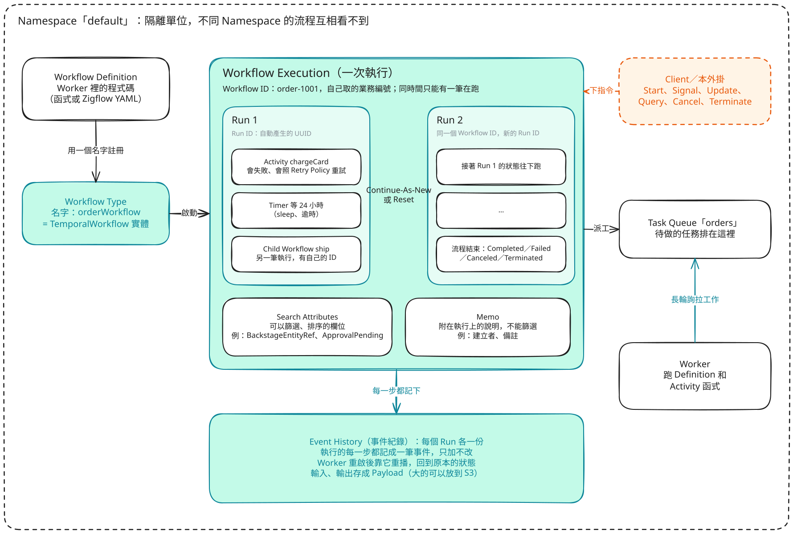
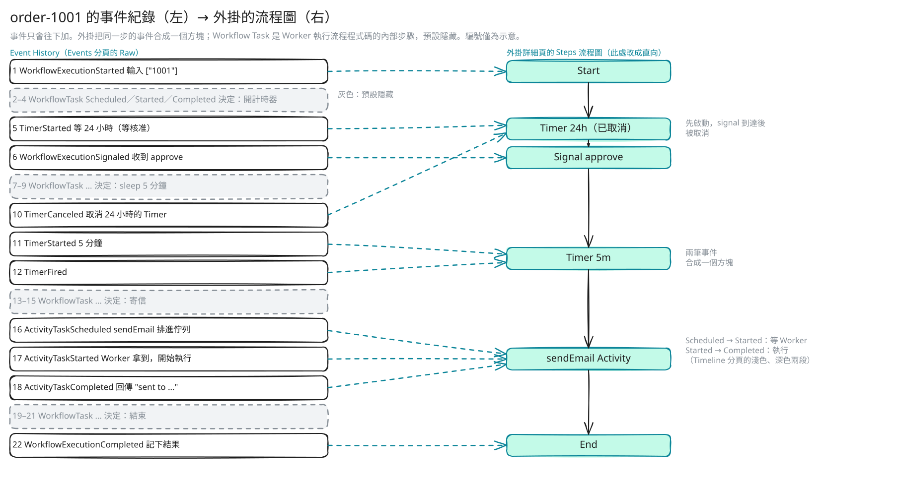

# Temporal 入門

[English](../temporal-primer.md) | 繁體中文

這篇回答一個問題：要看懂外掛的畫面，需要先知道哪些 Temporal 的知識？內容包括 Temporal 解決的問題、誰跟誰說話、核心概念、一個最小的範例，以及一次執行在事件紀錄裡的樣子。這是為這個外掛整理的摘要；細節和會隨版本改變的數字，請看連結的官方文件（英文）。

- [Temporal 解決什麼問題](#temporal-解決什麼問題)
- [誰跟誰說話](#誰跟誰說話)
- [核心概念](#核心概念)
- [最小的 TypeScript 範例](#最小的-typescript-範例)
- [一次執行在事件紀錄裡的樣子](#一次執行在事件紀錄裡的樣子)
- [延伸閱讀](#延伸閱讀)

下一篇[從 Temporal 概念到外掛](concepts-to-plugin.md)把下面每個概念對到畫面或設定。

## Temporal 解決什麼問題

一般的後端程式，一個請求處理一下就結束。可是很多業務流程不是這樣：要跑好幾天、要等人、中途會失敗。建立訂單、預留庫存、等主管簽核（可能三天）、部署、通知。自己寫的話，還得處理排程、重試、把狀態存進資料庫、重新啟動後從哪裡接著跑。Temporal 把這些包起來，你只要用一般的程式碼寫「流程該怎麼走」。

- **耐久執行（durable execution）。** 流程的每一步都記在伺服器上。Worker 當機或重新部署，流程從上次停下的地方接著跑，變數也都還在。
- **自動重試。** 呼叫外部服務失敗時，依重試策略（間隔、次數、哪些錯誤不重試）自動再試，不用自己寫 retry 迴圈。
- **長時間等待。** `await sleep('3 days')` 或等人簽核，等待期間不需要替它佔著執行緒或記憶體；時間到或訊息來了才繼續。
- **看得到發生什麼。** 每一次執行都有完整的事件紀錄：哪一步、何時、輸入輸出、失敗原因。外掛就是把這份紀錄畫出來。

官方文件：[What is Temporal?](https://docs.temporal.io/temporal)、[Understanding Temporal](https://docs.temporal.io/evaluate/understanding-temporal)、[Retry Policies](https://docs.temporal.io/encyclopedia/retry-policies)、[Workflow Execution](https://docs.temporal.io/workflow-execution)。想邊做邊學，可以上 [learn.temporal.io](https://learn.temporal.io/) 上 Temporal 101（有 TypeScript 版）。

## 誰跟誰說話

Temporal Service 本身不執行你的程式碼。它只負責記帳（事件紀錄）和派工（Task Queue）。真正執行程式碼的是你自己部署的 **Worker**：它向伺服器拉工作、執行、回報。

- **Client**（你的應用程式、Temporal CLI，或這個外掛的後端）啟動流程、對流程送訊息。
- **Temporal Service** 把每一步記成事件，並把下一件工作放進 Task Queue。
- **Worker** 註冊流程和 Activity 的程式碼，對 Task Queue 長輪詢（long poll），執行拿到的工作並回報結果。Worker 不開任何連接埠，是它主動連到伺服器，所以可以放在任何連得到伺服器的地方。要加大處理量，就多開幾個 Worker 聽同一個 Task Queue。

外掛是一個也會讀取的 Client。它連到伺服器的 Frontend（gRPC），遇到大型 Payload 時再連 S3。它不和 Worker 說話，也不碰 Temporal 的資料庫。

### Temporal Service 的內部

Service 是同一個程式依角色分成四種，可以各自擴充：**Frontend**（唯一的 gRPC 入口，Client、Worker 和這個外掛都連它）、**History**（每個 Workflow Execution 的狀態、事件紀錄和計時器）、**Matching**（管理 Task Queue，Worker 的長輪詢掛在這裡），以及跑 Temporal 自己系統流程的內部 **Worker**。`temporal server start-dev` 把所有角色放在同一個行程裡、用 SQLite，本版本庫的開發環境用的就是它。正式環境的部署請見 [Temporal Service](https://docs.temporal.io/temporal-service) 和 [self-hosted guide](https://docs.temporal.io/self-hosted-guide)。


由左邊讀起。所有連進來的（Client、CLI、輪詢中的你的 Worker、外掛的後端）都只和 Frontend 說話。Frontend 做 authorization、限流和驗證，再把流程相關的請求轉給 History，把輪詢轉給 Matching。History 管每個執行的狀態；執行分散在固定數量的 history shard 上，shard 數在建立叢集時決定，之後不能改。流程可以往前走時，History 把任務放進 Matching，由 Matching 配對給正在輪詢的 Worker（細節見下面）。內部 Worker 不是你的 Worker，它做的是 Temporal 自己的背景工作。

圖的右邊是後面的兩個儲存：**persistence**（流程狀態和紀錄；Matching 沒人拿的任務也存在這裡）和 **visibility**（清單和搜尋，由 History 寫入）。外掛靠查詢 visibility（橘色虛線）來列出流程，所以需要支援[進階 visibility](https://docs.temporal.io/self-hosted-guide/visibility) 的 Temporal（支援的 SQL 資料庫，或 Elasticsearch／OpenSearch），並且要先註冊 [`temporal.searchAttributes`](../../README.md#configuration) 裡寫的自訂 Search Attribute。用 Elasticsearch 時，剛啟動的流程可能要過一下才出現在清單裡。

### Task Queue 怎麼運作

Task Queue 不用事先建立；第一次有 Worker 或 Client 用到某個名字，它就存在了。同一個名字底下其實有兩條佇列，一條給 Workflow Task、一條給 Activity Task，Worker 分別輪詢。有 Worker 正在等的話，任務直接交過去；沒有的話就在佇列裡排著，等 Worker 來拿。一個任務只交給一個 Worker。沒有 Worker 在聽時，任務只是排著，流程不會失敗，只是不往前走。外掛把這種情形顯示成：已排進佇列但還沒開始的 Activity 上寫 "Waiting for a worker"。


圖上的編號以下面範例裡的 `order-1001` 為例：

1. Client 啟動流程，History 在 `orders` 的 Workflow Task 佇列排第一個 Workflow Task。
2. 正在長輪詢這條佇列的 Worker，如果正在等，就立刻拿到任務（sync match：任務不存進資料庫）。沒人在等，任務就存進資料庫排著（backlog），等 Worker 來輪詢。
3. Worker 執行流程程式碼，回報指令，例如「排 `sendEmail`」（圖上方橫跨的線，經 Frontend）。History 把它們記成事件，並在 Activity Task 佇列放一個 Activity Task。
4. 任何一個輪詢這條佇列的 Worker 都可以拿走它。同一條佇列上的兩個 Worker 分攤工作；一個任務只給一個 Worker。
5. 跑過某個流程的 Worker 會把它的狀態留在記憶體，伺服器之後會優先把這個流程的下一個 Workflow Task，經由只有它在輪詢的 "sticky" 佇列送給同一個 Worker，省掉重播紀錄。那個 Worker 如果沒有及時來拿，任務就退回一般佇列，任何 Worker 都可以拿。Activity Task 不使用 sticky 佇列。

每條佇列內部會切成幾個分區（partition）來分散負載，不用你設定，但可能影響任務交出去的先後順序。細節見 [Task Queues](https://docs.temporal.io/task-queue) 和 [Tasks](https://docs.temporal.io/tasks)。

## 核心概念

名詞保留英文，因為 Temporal 的文件、錯誤訊息和外掛的畫面都用英文。粗體是畫面上的文字。[從 Temporal 概念到外掛](concepts-to-plugin.md)有完整對照。



由左到右讀：程式碼（Workflow Definition）註冊成一個名字（Workflow Type），每啟動一次是一筆執行（Workflow Execution）。中間的大框是一筆執行：Workflow ID 是你自己取的業務編號；它可以由好幾個 Run 組成（Continue-As-New 或 Reset 之後換新的 Run ID），每個 Run 裡有 Activity、Timer、子流程這些步驟，也有自己的事件紀錄；Search Attributes 和 Memo 掛在執行上。右邊是 Client（或外掛）對執行下指令，Worker 從 Task Queue 拉工作來做。橘色虛線是外掛。

### 流程本身

- **Namespace。** 隔離的單位。不同 Namespace 的流程互相看不到，保留期限和存取控制也各自設定。外掛只讀取你列在 `temporal.connection.namespaces` 的 Namespace，也不會建立或修改 Namespace。畫面：**Workflow type** 卡片的 **Namespace** 欄；清單標題下的 "Namespace: default"。
- **Workflow Definition。** 描述流程怎麼走的程式碼，一個 async 函式。它必須可重播：同樣的事件紀錄要得出同樣的決定，所以不能直接讀時間、用亂數或打網路，這些要交給 Activity。畫面：核心外掛沒有對應畫面；用 YAML 或程式碼寫的流程可以透過[另外的模組](concepts-to-plugin.md#外掛自己加的東西)顯示 **Definition** 分頁。
- **Workflow Type。** 流程定義的名字，例如 `orderWorkflow`。啟動流程時用型別名稱指定要跑哪一個。畫面：**Workflow type** 欄位和卡片。
- **Workflow Execution。** 某個型別被啟動一次，像類別和物件的關係：定義只有一份，執行可以有很多筆。畫面：**Workflow executions** 清單的一列，和它的詳細頁。
- **Workflow ID 與 Run ID。** Workflow ID 是你取的業務編號，同一時間最多只有一筆開啟中的執行可以用它，可以拿來防止重複。Run ID 是伺服器產生的 UUID，每次 Continue-As-New（或整個流程重試）都會換新的。畫面：清單的 **Workflow ID** 欄；詳細頁標頭的 **Run ID** 和 `Run 2 of 3`。

### 做事的人和排隊的地方

- **Activity。** 流程裡和外界打交道的那一步：打 API、寫資料庫、寄信、呼叫模型。它可以失敗、可以重試、可以很慢，結果會記進事件紀錄。外掛流程圖上大部分的方塊是 Activity。畫面：流程圖上的方塊、**Steps** 表、步驟面板的 **Attempt**、**Details** 分頁的 **Pending activities**。
- **Worker。** 你自己的程式，註冊流程和 Activity 的程式碼，並輪詢工作。畫面：沒有；外掛沒有 Worker 清單，只在 Activity 排著沒人拿時顯示 "Waiting for a worker"。
- **Task Queue。** 伺服器上有名字的排隊區。畫面：清單和詳細頁的 **Task queue** 欄位。
- **Retry Policy。** Activity 失敗時怎麼重試：第一次間隔、倍數、最多幾次、哪些錯誤不重試。Activity 預設會無限重試，所以要自己設上限。畫面：方塊上的 `×3`、時間軸的 "2 retries"；策略本身不顯示。
- **Timer。** 流程裡的 `sleep()` 或等待的逾時，由伺服器計時；計時期間 Worker 什麼都不用做。畫面：標題為 `Timer 24h` 的方塊，副標題寫明何時觸發（例如 `Fires in 23h 59m`），步驟面板有 **Fires** 欄位。如果這個 Timer 是某次等待的時間限制，而且設了 `…Pending` 屬性，方塊會改寫 "Waiting for approval"，副標題是 "Times out in …"。

一個重試過的 Activity 在圖上是一個方塊。在時間軸上，淺色長條涵蓋在佇列裡等待、失敗的嘗試和重試間隔，實心長條是最後執行的那一次嘗試。


把每一列看成「現在任務在誰手上」。上面一列，任務在 Task Queue 等；中間一列，Worker 執行一次嘗試。嘗試失敗後，等重試間隔的是 Server 而不是 Worker，等完再把任務重新放回佇列；這段等待和 Timer 期間，Worker 都不佔任何東西。圖上的間隔來自下面範例的重試策略（預設值：初始間隔 1 秒、倍數 2）。為了讓 Activity 和 Timer 排在同一條時間軸上，圖裡是 Activity 之後才睡；下面的範例則是先睡再寄信。事件紀錄只留最後一次嘗試（見[一次執行在事件紀錄裡的樣子](#一次執行在事件紀錄裡的樣子)），所以外掛能顯示 `×3` 和 "2 retries"，但看不到每一次嘗試。

### 紀錄

- **Event History。** 一個 Run 的所有事件，依序編號，只會往後加。它是 Temporal 判斷流程狀態的唯一依據：Worker 重新啟動時，就是重播這份紀錄把流程狀態算回來。流程圖、時間軸和 **Steps** 表都是從它算出來的。畫面：**Events** 分頁。

### 和執行中的流程溝通


圖的左半是這一節：藍綠色箭頭會寫進事件紀錄，虛線的 Query 不會（被 validator 拒絕的 Update 也不會）。右半是下一節；最下面一排和 Search Attributes 方塊屬於「找流程、帶資料」：Payload 先經過 Data Converter，再經過選用的 Codec，再經過 External Storage，最後才進到事件紀錄，所以用了加密的 Codec 時，放進 S3 的內容已經是加密過的。

- **Signal。** 從外面丟一個訊息進流程，不等回覆。流程在 handler 裡接住並改變狀態，會記進事件紀錄。畫面：**Signal…** 按鈕；流程圖上的 Signal 步驟。
- **Query。** 讀流程目前的狀態，不改任何東西，也不記進事件紀錄。流程結束後也能查，只要有 Worker 在線。畫面：**Query…** 按鈕。
- **Update。** 像 Signal，但會等流程處理完並回傳結果，而且 validator 可以在記錄之前就拒絕不合法的請求。畫面：**Update…** 按鈕；流程圖上的 Update 步驟（被拒絕的 Update 不在事件紀錄裡，所以不顯示）。
- **Cancel 與 Terminate。** Cancel 是請流程停下來，流程可以收尾（例如復原已做的變更）。Terminate 是直接結束，流程不會執行任何程式碼，而且要填原因。畫面：**Cancel**、**Terminate** 按鈕。外掛另外提供 **Rerun**：用相同的輸入再啟動一次新的執行。這是外掛自己的組合操作，不是 Temporal 的 API。

### 長時間執行的流程

- **Continue-As-New。** 一個 Run 的事件紀錄有大小上限（見 [Event History](https://docs.temporal.io/encyclopedia/event-history)），所以跑很久或迴圈很多次的流程，會接續成新的 Run：同一個 Workflow ID、新的 Run ID、空的紀錄，並帶著狀態。外掛把這些 Run 串起來。畫面：`Run 2 of 3`、前一個和下一個 Run 的連結，以及狀態 **Continued as new**。
- **Child Workflow。** 由另一個流程啟動的流程，有自己的 ID 和紀錄；父流程可以等它的結果。畫面：子流程方塊，連到子流程自己的詳細頁。

### 找流程、帶資料

- **Search Attributes。** 掛在執行上、可以搜尋和篩選的欄位；型別要先在伺服器上註冊。**Memo** 則是不能搜尋的附註。外掛用 Search Attribute 判斷流程屬於哪個實體（`BackstageEntityRef`）和誰啟動的（`BackstageInitiator`）。畫面：**Details** 分頁的 **Search attributes** 和 **Memo**。名稱以 `Pending` 結尾的屬性會變成 "Waiting for …"（[說明](concepts-to-plugin.md#pending-search-attribute-的約定)）。
- **Payload 與 Data Converter。** 流程的輸入、輸出和 Activity 的參數都存成 Payload：metadata（例如 `encoding: json/plain`）加上位元組。Data Converter 負責物件和 Payload 互轉。畫面：步驟面板裡的輸入、輸出，以 JSON 顯示。
- **Codec。** 接在 Data Converter 之後，對整個 Payload 再轉換一次，通常是加密或壓縮。加密之後，伺服器和任何 UI 都讀不到內容，除非用 Codec Server 解碼。畫面：外掛遇到解不開的 Payload 只顯示編碼和大小；外掛不解密。
- **External Storage。** SDK 的功能（public preview）：把超過門檻的 Payload 存進 S3，紀錄裡只留一個參照。門檻和版本請看 [External Storage](https://docs.temporal.io/external-storage)。畫面：步驟面板顯示儲存的內容、預覽或縮圖，並可下載（[設定方式](../../README.md#large-payloads-external-storage)）。

## 最小的 TypeScript 範例

一個訂單流程：等主管用 Signal 核准（最多 24 小時），等五分鐘，然後寄信。用到的套件是 `@temporalio/workflow`、`@temporalio/activity`、`@temporalio/worker` 和 `@temporalio/client`。

**activities.ts**（可以呼叫外部）

```ts
// Activity 是一般的 async 函式，可以做任何 I/O。
export async function sendEmail(to: string): Promise<string> {
  // 寄信。丟出錯誤的話，由 Retry Policy 決定怎麼辦。
  return `sent to ${to}`;
}
```

**workflows.ts**（必須可重播）

```ts
import {
  proxyActivities,
  defineSignal,
  setHandler,
  condition,
  sleep,
} from '@temporalio/workflow';
import type * as activities from './activities';

const { sendEmail } = proxyActivities<typeof activities>({
  startToCloseTimeout: '1 minute',
  retry: { maximumAttempts: 5 },
});

export const approve = defineSignal<[string]>('approve');

export async function orderWorkflow(orderId: string) {
  let approvedBy: string | undefined;
  setHandler(approve, by => {
    approvedBy = by;
  });

  // Timer：最多等 24 小時，等待期間不佔資源。
  const ok = await condition(() => !!approvedBy, '24 hours');
  if (!ok) return 'timed out';

  await sleep('5 minutes');
  return await sendEmail(`${orderId}@example.com`);
}
```

**worker.ts**（你部署的程式）

```ts
import { NativeConnection, Worker } from '@temporalio/worker';
import * as activities from './activities';

async function main() {
  const connection = await NativeConnection.connect({
    address: 'localhost:7233',
  });
  const worker = await Worker.create({
    connection,
    namespace: 'default',
    taskQueue: 'orders', // 這個 Worker 輪詢的佇列
    workflowsPath: require.resolve('./workflows'),
    activities,
  });
  await worker.run();
}

main().catch(err => {
  console.error(err);
  process.exit(1);
});
```

**client.ts**（啟動流程、送 Signal）

```ts
import { Client, Connection } from '@temporalio/client';
import { orderWorkflow, approve } from './workflows';

async function main() {
  const client = new Client({
    connection: await Connection.connect({ address: 'localhost:7233' }),
  });
  const handle = await client.workflow.start(orderWorkflow, {
    taskQueue: 'orders',
    workflowId: 'order-1001', // 業務編號，防止重複
    args: ['1001'],
  });
  await handle.signal(approve, 'manager-a');
  console.log(await handle.result());
}

main().catch(err => {
  console.error(err);
  process.exit(1);
});
```

想在本機試跑：執行 `temporal server start-dev`（含 Web UI 的開發用伺服器），再分別執行 Worker 和 Client。

## 一次執行在事件紀錄裡的樣子

上面的 `order-1001` 跑完後，事件紀錄大致像下圖左半邊。外掛把每一步的事件分組，畫成一個方塊。



事件依序編號、只會往後加。Workflow Task（灰色）是 Worker 執行流程程式碼的內部步驟，外掛預設隱藏。`condition(…, '24 hours')` 會啟動一個 Timer；Signal 讓條件成立後，SDK 會把它取消（`TimerCanceled`），所以第一個 Timer 方塊標成已取消。兩筆事件（`TimerStarted`、`TimerFired`）合成第二個 Timer 方塊；`ActivityTaskScheduled`、`Started`、`Completed` 合成一個 Activity 方塊，時間軸把它的時間分成「等 Worker」（scheduled 到 started）和「執行中」（started 到 completed）。圖上的編號只是示意。

Temporal 只記錄 Activity 最後一次嘗試，以及前一次嘗試的失敗。所以外掛能顯示步驟目前是第幾次嘗試和最新的錯誤，但看不到更早每一次重試的細節。

### 耐久執行就是重播

Temporal 存的不是 Worker 的記憶體，而是上面那份事件紀錄；需要時再把流程程式碼重新跑一次，把狀態算回來。

- **每一步都變成事件。** 流程程式碼要呼叫 Activity、開 Timer 或等 Signal 時，SDK 會送一個指令給伺服器，由伺服器記成事件。
- **重播。** Worker 當機或重新部署後，接手的 Worker 從頭執行流程程式碼。已經有事件的步驟不會真的再做一次，SDK 把紀錄裡的結果交還給程式碼。所謂「變數都還在」，其實是重新算出來的。
- **代價是決定性（determinism）。** 重播同一份紀錄必須得出同樣順序的指令。所以流程程式碼不能直接用亂數、現在的時間、網路或檔案；這些要放進 Activity，它們的結果會被記下來。TypeScript SDK 把流程放在沙箱裡，把 `Math.random` 和 `Date` 換成可重播的版本。如果你改了步驟的順序，執行中的流程就無法再重播（nondeterminism error），要用 patching 處理（[TypeScript versioning](https://docs.temporal.io/develop/typescript/workflows/versioning)）。
- **不是每次都要重播。** 有了 sticky queue，Worker 把狀態留在記憶體，只有狀態被清掉或換了 Worker 才重播。
- **紀錄太長**就用 Continue-As-New（見上面）；外掛的 **Continued as new** 狀態就是這個。

參考 [Event History](https://docs.temporal.io/encyclopedia/event-history)，以及 [Workflow Definition](https://docs.temporal.io/workflow-definition) 裡關於決定性的限制。

## 延伸閱讀

1. [Temporal 101](https://learn.temporal.io/courses/temporal_101/) 和 [Temporal 102](https://learn.temporal.io/courses/temporal_102/)：官方免費課程，有 TypeScript 版。102 講耐久執行、測試和除錯。
2. [Interacting with Workflows](https://learn.temporal.io/courses/interacting_with_workflows/)：講 Signal、Query、Update，也就是外掛 **Signal…**、**Update…**、**Query…** 三個按鈕背後的三種訊息。
3. [How Durable Execution Works](https://temporal.io/blog/building-reliable-distributed-systems-in-node-js-part-2)：用 TypeScript 說明 Worker 怎麼重播紀錄。
4. [Designing a Workflow Engine from First Principles](https://temporal.io/blog/workflow-engine-principles/)：Temporal Service 本身怎麼設計。
5. [awesome-temporal](https://github.com/temporalio/awesome-temporal)：更多資料。

下一篇：[從 Temporal 概念到外掛](concepts-to-plugin.md)。
