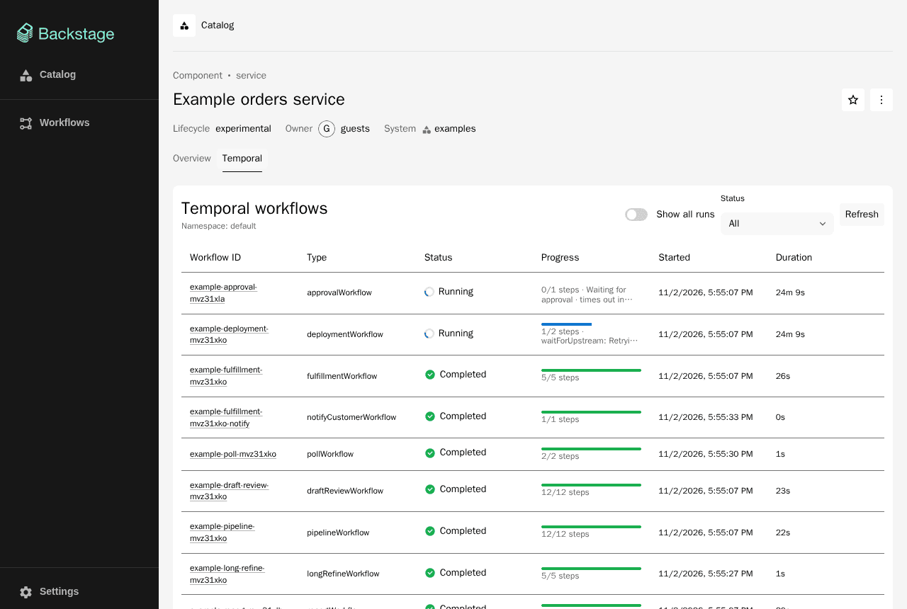
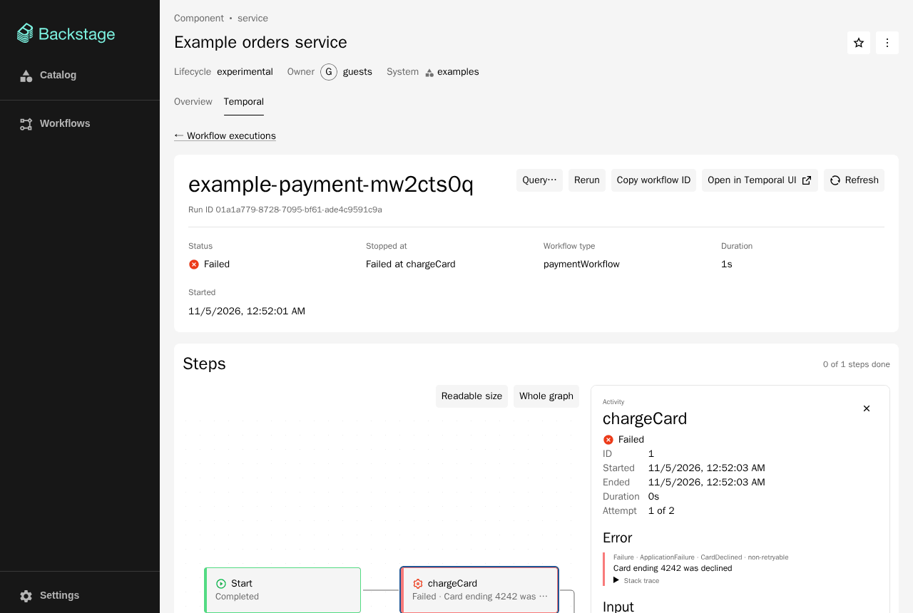
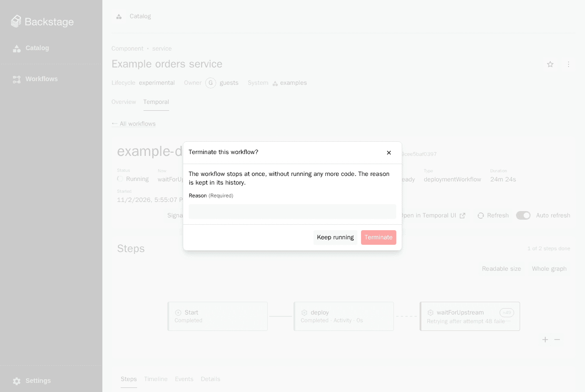
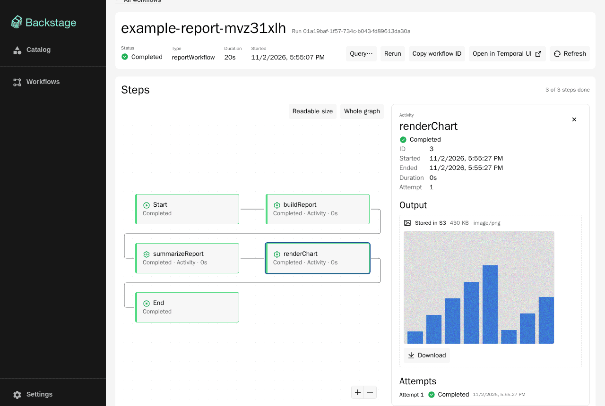
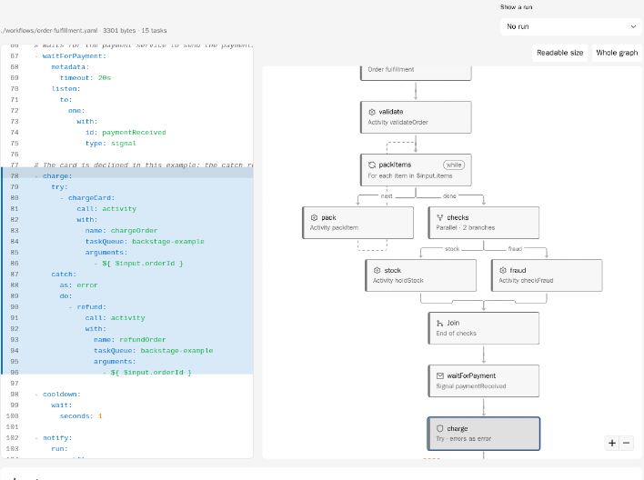
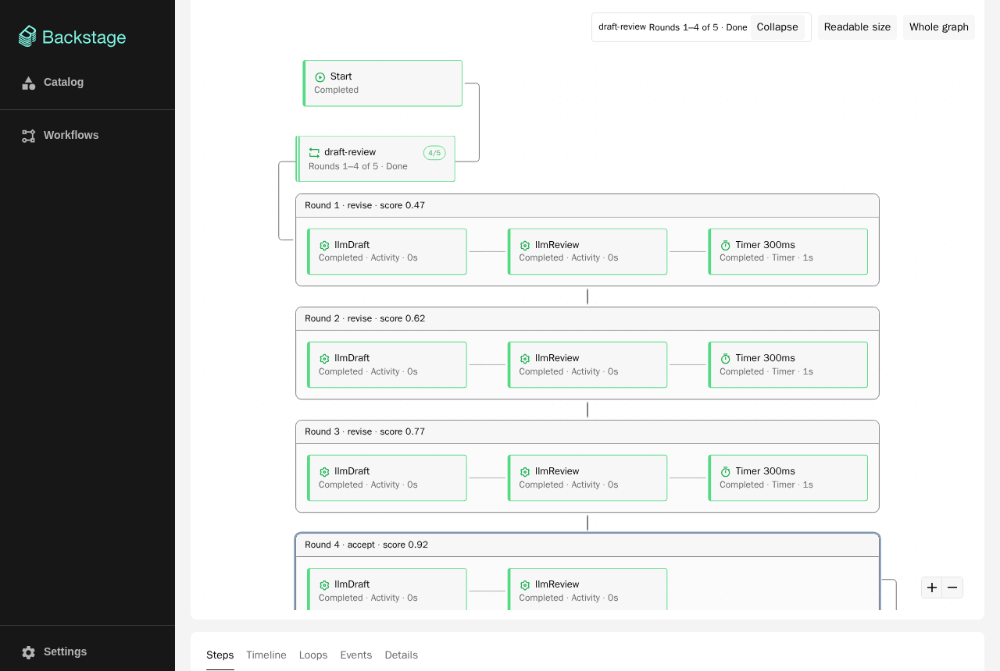
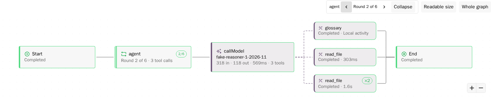

# 導覽

[English](../walkthrough.md) | 繁體中文

這篇帶你在自己的機器上，用本版本庫的開發用 app 和範例 Worker 把外掛走一遍。它回答：各個畫面顯示什麼？操作一個流程時發生了什麼事？預計花約兩小時。走完你會碰過 Temporal 的核心概念、外掛的每個畫面和操作，也知道出了問題去哪裡看。每一步都寫了要看什麼、為什麼。

這裡只用本版本庫裡有的東西：開發用 app（`packages/app`、`packages/app-next`、`packages/backend`）、範例 Worker（`packages/example-worker`）、`examples/entities.yaml` 裡的 catalog 實體，以及選用的 `examples/` 底下的 Docker Compose 檔。需要 Docker 的步驟會註明，而且都是選用的。

- [0. 開始之前](#0-開始之前)
- [1. 啟動環境](#1-啟動環境)
- [2. 在 catalog 裡找到流程](#2-在-catalog-裡找到流程)
- [3. 讀一次執行](#3-讀一次執行)
- [4. 操作執行中的流程](#4-操作執行中的流程)
- [5. 長流程、子流程、大型資料](#5-長流程子流程大型資料)
- [6. 用 YAML 寫的流程定義（選用）](#6-用-yaml-寫的流程定義選用)
- [7. AI 流程（實驗性）](#7-ai-流程實驗性)
- [8. 從 Temporal 這一側看](#8-從-temporal-這一側看)
- [9. 自動化檢查與收尾](#9-自動化檢查與收尾)
- [走完之後應該會的](#走完之後應該會的)

## 0. 開始之前

花大約 20 分鐘讀完 [Temporal 入門](temporal-primer.md)到「核心概念」。你只需要分得出 Workflow Type、Workflow Execution、Event History、Activity、Signal、Query、Update 的差別；其他的邊做邊懂。[從 Temporal 概念到外掛](concepts-to-plugin.md)是可以一直開著的對照表。

你需要 Node.js 22 或 24、透過 Corepack 的 Yarn 4，以及 [Temporal CLI](https://docs.temporal.io/cli)（在本機開 Temporal 伺服器；也可以用 Docker，見 [README 的 Development 一節](../../README.md#development)）。整套環境是一個 Temporal 開發用伺服器、Backstage 的後端和前端，加上一個 Worker；筆電跑得動，但不要和很重的建置同時進行。

## 1. 啟動環境

1. 安裝相依套件：

   ```sh
   corepack enable
   yarn install
   ```

2. 啟動 Temporal 開發用伺服器，並註冊外掛和範例 Worker 會用到的 Search Attribute：

   ```sh
   temporal server start-dev \
     --search-attribute BackstageEntityRef=Keyword \
     --search-attribute BackstageInitiator=Keyword \
     --search-attribute ApprovalPending=Bool
   ```

   它監聽 `localhost:7233`，也就是 `app-config.yaml` 預期的位址。它的 Web UI 預設在 <http://localhost:8233>；開發設定檔裡的連結是 `http://localhost:8080`，所以如果想讓 **Open in Temporal UI** 可以用，下一個指令前請先設 `TEMPORAL_UI_URL=http://localhost:8233`。

3. 在第二個終端機啟動 app 和後端（`yarn start:next` 則啟動新前端系統的 app）：

   ```sh
   yarn start
   ```

   打開 <http://localhost:3000>，用 guest 使用者登入。後端在 <http://localhost:7007>。開發用後端允許所有權限（allow-all 政策），所以每個按鈕都能用。

4. 在第三個終端機啟動範例流程：

   ```sh
   yarn workspace example-worker start
   ```

   它會替 `example-orders` 元件，在 `backstage-example` Task Queue 上啟動一批流程（成功的、失敗的、執行中的、有重試的、有 Timer 的、有子流程的、有迴圈的等等），並印出 workflow ID。ID 長得像 `example-order-<suffix>`，suffix 是啟動時間的 36 進位表示。這個指令會先跑一個 Worker，直到已結束的流程都完成，再對 approval 流程送一個 `comment` Signal，接著等 deployment 流程出現重試中的 Activity，然後在幾十秒後結束。deployment 和 approval 流程則會一直開著。

5. Signal、Update、Query，以及從 Backstage 啟動的流程，都需要一個持續輪詢的 Worker。在第三個終端機（或第四個）讓它一直跑到你做完為止：

   ```sh
   yarn workspace example-worker serve
   ```

**要看什麼：** 第 4 步印出的 ID，以及指令最後一行 `deploymentWorkflow is running: …`。後面的步驟會用到。

**為什麼：** 外掛只讀取 Temporal 並對它下指令，不執行流程程式碼；執行的是 Worker。沒有 Worker，流程就不會往前走，需要 handler 的操作（Update、Query）也會逾時。

## 2. 在 catalog 裡找到流程

1. 在 Backstage 打開 **Catalog**。清單一開始篩選的 kind 是 **Component**，顯示的是實體的標題：**Example checkout service**、**Example orders service**（實體 `example-orders`），以及沒有標題的 `example-website`。把 kind 篩選改成 **TemporalWorkflow**，會看到五個流程實體，例如 **Example order workflow** 和 **Example ticket workflow**。一個實體就是一個 Workflow Type。（**Example order jobs** 是 `Resource`，要在那個 kind 底下才看得到。）
2. 打開 **Example order workflow**。**Overview** 有一張 **Workflow type** 卡片，寫著流程類型、Task Queue 和 Namespace，並有 **Open in Temporal UI** 連結。分頁有 **Overview**、**Temporal**、**Definition**。
3. 打開 **Example checkout service** 的 **Temporal** 分頁。這個實體在 `spec.dependsOn` 列了 `example-order-workflow` 和 `example-payment-workflow`，所以分頁有一張 **Workflow types** 卡片列出這兩者，也列出這兩者的執行，以及它自己的標註對到的執行。
4. 對照 `example-website`：它沒有 Temporal 標註，也沒有相依，所以只有 **Overview** 分頁。**Example order jobs** 是 `Resource` 而不是元件，卻仍然有 **Temporal** 分頁，只列出訂單流程：外掛不依賴實體的 kind。

**為什麼：** 外掛靠 `TemporalWorkflow` 實體或 `temporal.io/*` 標註，知道「這個實體的流程」是哪些。把 `examples/entities.yaml` 開在旁邊，就能看到每一個背後的 YAML。見[概念對照](concepts-to-plugin.md#外掛自己加的東西)。

## 3. 讀一次執行

打開 **Example orders service** 的 **Temporal** 分頁，裡面是 **Workflow executions**。



1. **清單。** 看狀態（Completed、Failed、Running）、時間，和進度欄：目前在哪一步，或失敗在哪一步（例如 `0/1 steps · Waiting for approval · times out in 23h 58m`，或 `0/1 steps · Failed at chargeCard`）。試試狀態篩選和 **Show all runs**；網址會跟著變，所以瀏覽器的上一頁會回到同一頁。
2. **失敗的執行。** 打開 `example-payment-…`。標頭顯示 Workflow ID、Run ID、狀態和停在哪裡（`Failed at chargeCard`）。**Steps** 流程圖裡失敗的方塊是紅色的；點選它，右邊的面板會顯示失敗類型和訊息（`CardDeclined`、`Card ending 4242 was declined`）、嘗試次數、輸入和輸出。流程本身失敗的原因鏈（`PaymentFailed`，起因是 Activity 失敗，再起因於 `CardDeclined`）在 **Details** 分頁的 **Failure** 底下。

   

3. **重試、並行步驟、Timer、子流程。** 打開 `example-fulfillment-…`。兩個 Activity（`pickItems`、`printLabel`）並行執行，所以流程圖有兩條分支。`bookCourier` 顯示 `×3`：它失敗兩次，第三次成功。後面是 **Timer 2s** 方塊（流程睡兩秒，時間由 Temporal 伺服器計），再來是子流程方塊 `notifyCustomerWorkflow`。
4. **Timeline。** 在同一筆執行打開 **Timeline** 分頁。每個 Activity 有淺色長條（等 Worker，包含先前的嘗試和重試間隔）和實心長條（成功完成的那一次執行）。游標移上去看時間；在圖上拖曳可以放大。
5. **Events。** **Grouped** 檢視把每一步的事件收合；**Raw** 是照實記錄的 Event History（`WorkflowExecutionStarted`、`WorkflowTaskScheduled`、`ActivityTaskScheduled` …）。打開 **Show workflow tasks** 可以看到預設隱藏的內部事件。
6. **Details。** 看 Search Attribute（`BackstageEntityRef` 就是外掛找出流程所屬實體的方式）、Memo，以及執行中流程的 **Pending activities**。`example-deployment-…` 有一個一直在重試的 Activity `waitForUpstream`。
7. **對照。** 按 **Open in Temporal UI**，在 Temporal Web UI 看同一筆執行（需要 1.3 設的 `TEMPORAL_UI_URL`）。

**為什麼：** 所有畫面都是從同一份 Event History 算出來的。看得懂原始事件和方塊的對應，就懂了[事件紀錄與重播](temporal-primer.md#一次執行在事件紀錄裡的樣子)。

## 4. 操作執行中的流程

這幾步需要 1.5 的 Worker，並且用到開發用 app 已安裝的 control 模組。

執行中流程的頁面，在瀏覽器分頁位於前景時，每十秒重新載入一次；**Auto refresh** 開關可以關掉它。**Refresh** 按鈕按下後會鎖住，要等重新載入結束而且至少過了一秒才能再按，所以連按只會送出一次請求。

1. **等簽核的流程。** 打開 `example-approval-…`（狀態 Running）。進度欄寫 **Waiting for approval · times out in …**：這個流程啟動時就帶著 Search Attribute `ApprovalPending` 為 true，外掛把它翻成這句話（[說明](concepts-to-plugin.md#pending-search-attribute-的約定)）。流程圖上已經有一個 `comment` Signal 步驟：1.4 的指令送過一個。
   - 按 **Signal…**，名稱保持 `comment`，參數填 `"looks fine"`。對話框顯示 `Signal comment sent`，流程圖多一個 Signal 步驟。
   - 按 **Update…**，名稱已經填好 `approve`。送出 `""`。流程的 validator 會拒絕它：對話框顯示 `approver is required`，被拒絕的 Update 在事件紀錄裡**不會**留下任何痕跡。
   - 再送出 `approve`，參數填 `"alice"`。對話框顯示 `Update approve done` 和回傳值（`{"approvedBy":"alice"}`）。流程圖多一個 Update 步驟，Timer 24h 方塊標成 **Canceled**（等待先結束，Timer 還沒到期就被取消），流程隨之結束。
2. **客服單。** 打開 **Example ticket workflow** 實體的 **Temporal** 分頁，按 **Start workflow**。對話框寫著 `Starts ticketWorkflow on task queue backstage-example`，輸入由實體的 `spec.exampleInput` 預填。按 **Start**；新的執行會打開（`ticketWorkflow-<suffix>`），並顯示 **Waiting for an external event (signal or update)**。
   - **Signal…** `addNote`：對話框依實體的輸入 schema 顯示表單（**Note**，預填 `Called the customer`）。
   - **Query…** `state`：結果顯示標題、優先順序、備註和狀態。Query 不改任何東西，也不會留在事件紀錄裡。
   - **Update…** `setPriority` 填 `"high"` 會回傳 `{"previous":"normal","priority":"high"}`；填 `"urgent"` 會被 validator 拒絕（`priority must be one of low, normal, high`）。
   - **Escalate** 按鈕來自開發用後端註冊的一個自訂 action（`packages/backend/src/escalateAction.ts`）；見[擴充點](architecture.md#擴充點)。它會先問 `Raise the priority of this ticket to high?`，確認後把優先順序設成 high。
   - 送出 `close` Signal：流程結束。
3. **Cancel 和 Terminate。** 再用 **Start workflow** 啟動兩張客服單（它們會一直跑到被關閉）。對其中一張按 **Cancel** 並確認（**Cancel workflow**）：流程有機會回應；這個流程沒有要收尾的事，所以狀態變成 **Canceled**。對另一張按 **Terminate**：要填原因。確認之後狀態是 **Terminated**，摘要寫著 `Stopped at: Terminated: <你填的原因>`，原因也在 **Details** 分頁的 **Failure** 底下。
4. **Rerun。** 打開一筆已結束的執行，按 **Rerun** 並確認：用相同的輸入、類型和 Task Queue、換新的 Workflow ID（`<舊 ID>-rerun-<suffix>`）啟動一筆新的流程，並直接打開它。
5. **是誰做的。** 在 Temporal Web UI 裡，這些操作的歷史事件顯示的 identity 是 `backstage:user:default/guest`。



**為什麼：** Signal、Update、Cancel、Terminate 會寫進事件紀錄，Query 不會。正式環境要寫權限政策，因為開發用後端什麼都允許；見 [Permissions](../../README.md#permissions) 和[運作方式](how-it-works.md#圖一一個請求經過各層)。

## 5. 長流程、子流程、大型資料

1. **Continue-As-New。** 範例 Worker 會啟動 `pollWorkflow`，它會 Continue-As-New 三次。打開它那一列：標頭寫 `Run 4 of 4`，旁邊的 ⓘ 有說明，**← Run 3** 連結會到前一個 Run。前面幾個 Run 的狀態是 **Continued as new**；在清單打開 **Show all runs** 就能看到四筆。
2. **子流程。** 在 `example-fulfillment-…` 裡，點子流程方塊（`notifyCustomerWorkflow`）：步驟面板會顯示它的輸入和輸出，面板裡的 **Workflow** 欄位連到子流程自己的詳細頁。
3. **大型 Payload（選用，需要 Docker）。** Temporal 可以把大的 Payload 存在 S3，紀錄裡只留一個參照。這需要為後端和 Worker 換一組設定，所以要重新啟動它們。README 的 [Development 一節](../../README.md#development)把同樣的指令寫成一個區塊；這裡逐步編號，並說明順序為什麼重要（先停、設變數、RustFS、app 和後端、Worker）：

   1. 先停掉正在跑的東西：1.5 的 Worker（Ctrl+C）和 `yarn start`（Ctrl+C；前端和後端都會停）。Temporal 開發用伺服器留著。
   2. 在下面每個終端機都先設好本機 RustFS 的變數：

      ```sh
      export PAYLOAD_S3_ENDPOINT=http://localhost:9100 PAYLOAD_S3_BUCKET=temporal-payloads
      export PAYLOAD_S3_ACCESS_KEY=dev-access PAYLOAD_S3_SECRET_KEY=dev-secret-key
      ```

   3. 啟動 RustFS：`docker compose -f examples/docker-compose.rustfs.yaml up -d`。
   4. 用額外的設定檔重新啟動 app 和後端（路徑相對於 `packages/app` 和 `packages/backend`）。如果要用 **Open in Temporal UI**，請像 1.3 一樣再設一次 `TEMPORAL_UI_URL`：

      ```sh
      yarn start --config ../../app-config.yaml --config ../../app-config.s3.yaml
      ```

   5. 在另一個終端機，用同樣的變數執行 `yarn workspace example-worker start`。它會建立 bucket，啟動一批新的流程（這次包含 `reportWorkflow`），並把超過 128 KiB 的 Payload 存進 S3。它結束後，如果還想操作流程，再用同樣的變數執行 `yarn workspace example-worker serve`。

   打開 `example-report-…`，選 `buildReport` 和 `renderChart`。輸出會顯示 **Stored in S3**、大小和媒體類型：JSON（1 MB）超過內嵌顯示的上限，所以面板只顯示一小段預覽和 **Download** 按鈕，PNG 圖表（430 KB）也有 **Download** 按鈕。外掛從 S3 讀回物件並核對了它們的 SHA-256。做完請停掉 RustFS（設好變數後執行 `docker compose -f examples/docker-compose.rustfs.yaml down -v`）。

   

**為什麼：** 事件紀錄有大小上限，所以長流程要 Continue-As-New，大的 Payload 要放到外面。見入門裡的[長時間執行的流程](temporal-primer.md#長時間執行的流程)。

## 6. 用 YAML 寫的流程定義（選用）

YAML 範例在 [Zigflow](https://github.com/zigflow/zigflow) 裡執行，需要 Docker。照 README 的 [Development 一節](../../README.md#development)啟動 Zigflow 容器，再執行 `yarn workspace example-worker zigflow`（它會啟動兩筆 YAML 流程：一筆成功，一筆因為沒人送 `paymentReceived` 而失敗）。然後打開 **Example YAML order workflow** 實體的 **Definition** 分頁。YAML 上方寫著 `./workflows/order-fulfillment.yaml`、檔案大小和 task 數量：

1. YAML（`examples/workflows/order-fulfillment.yaml`）在左邊，流程圖在右邊。點一個方塊，對應的行會標出並捲到；點一行，會選到最內層的 task。
2. **Show a run** 是一個選單，一開始是 `No run`，列出最近的執行（`Completed · example-yaml-order-…`、`Failed · example-yaml-unpaid-…`）。選一筆：每個方塊依實際發生的事上色（跑過不只一次的 task 會標次數），**Open the run** 會到那次執行的詳細頁。
3. 對照用程式碼寫的 **Example order workflow**：它的 Definition 分頁寫著 `This workflow is written in code`，並依標註連到原始碼（**View the file**）。



這個分頁屬於兩個選用的套件；見 [Workflow definitions](../../README.md#workflow-definitions)。

## 7. AI 流程（實驗性）

開發用 app 打開了 `temporal.experimental.aiWorkflows`；在你自己的 app 裡這些畫面預設是關的，之後會移到獨立套件，也不承諾相容性。範例 Worker 啟動的是假的 AI 流程，不會呼叫任何模型。

1. **迴圈。** `draftReviewWorkflow` 產生、檢查、修改，直到分數夠高（在第 4 輪、最多 5 輪中完成）。流程圖把迴圈收成一個方塊；展開後一輪一個框。**Loops** 分頁（只有含迴圈的流程才有）由新到舊列出每一輪的決定和分數。`longRefineWorkflow` 跑 25 輪、每 10 輪 Continue-As-New 一次，所以它的輪次跨三個 Run 計算（`Run 3 of 3`）；它最後顯示 `Round 25 of 25 · Out of rounds`，因為範例永遠達不到目標。

   

2. **LLM 步驟。** 在 `example-agent-…` 裡，迴圈是一個方塊（`agent`），按 **Expand** 展開。每次模型呼叫（`callModel`，標著模型、token 數和工具數）是一個方塊，工具掛在旁邊；其中一個工具（`read_file`）會重試，`glossary` 則是 local activity。選一個模型呼叫：面板顯示輸入、thinking、輸出、tool call 和用量。`mixedAgentWorkflow` 混合了一般的 Activity、模型呼叫、並行的工具和一個子流程。

   

**為什麼：** Temporal 只看到一串 Activity。這些標記由 workflow kit 寫入、外掛讀回。見 [Loops](../../README.md#loops) 和 [LLM steps](../../README.md#llm-steps)。

## 8. 從 Temporal 這一側看

用 CLI（同一個伺服器，`localhost:7233`）：

```sh
temporal workflow list
temporal workflow list --query "BackstageEntityRef='component:default/example-orders'"
temporal workflow show --workflow-id <第 1 步印出的某個 workflow ID>
```

`workflow show` 的事件和 **Raw** 事件一一對應。兩份清單的筆數不會完全一樣，這是正常的。外掛向 Temporal 查的是：屬於這個實體的 Task Queue 和流程類型的執行，或在 `BackstageEntityRef` Search Attribute 裡帶著這個實體的執行；而且在沒有打開 **Show all runs** 時，會排除已經 Continue-As-New 的 Run（`ExecutionStatus != 'ContinuedAsNew'`），所以一個流程只有一列。CLI 則列出每一個 Run。每一批範例流程有五個 Continue-As-New 的 Run（`pollWorkflow` 三個、`longRefineWorkflow` 兩個），所以在打開 **Show all runs** 之前，CLI 每一批會比外掛多列五筆。實際的筆數還會隨你啟動過幾批、跑過幾張客服單而增加。

## 9. 自動化檢查與收尾

版本庫的 Playwright smoke test 會走過這裡的許多畫面，並替每一步截圖（`yarn test:e2e`；新前端系統的 app 用 `yarn test:e2e:next`；見 README 的 [Development 一節](../../README.md#development)）。需要先執行 `npx playwright install chromium`。

收尾時，用 Ctrl+C 停掉每個行程。如果你有啟動 Zigflow 容器（`docker rm -f zigflow`）和 RustFS 的 compose 專案，也要停掉（設好 `PAYLOAD_S3_*` 變數後執行 `docker compose -f examples/docker-compose.rustfs.yaml down -v`）。除非你給了資料庫檔案，否則開發用的 Temporal 伺服器把資料放在記憶體裡，停掉它就會忘記這些流程。

## 走完之後應該會的

- [ ] 說得出 Workflow Type、Workflow Execution、Run ID 的差別，並在畫面上指出各自在哪裡。
- [ ] 從流程圖找到失敗的步驟、它的錯誤和嘗試次數。
- [ ] 在原始事件裡找到一個 Activity 的 scheduled、started、completed 事件。
- [ ] 送過 Signal、Query、Update，說得出哪些會記進事件紀錄。
- [ ] 說明 Cancel 和 Terminate 的差別。
- [ ] 在 Continue-As-New 的各個 Run 之間跳轉，並打開一個子流程。
- [ ] 說明為什麼流程會顯示 **Waiting for approval**。
- [ ] 用 Temporal CLI 找到同一批流程。

回到[文件索引](README.md)。
