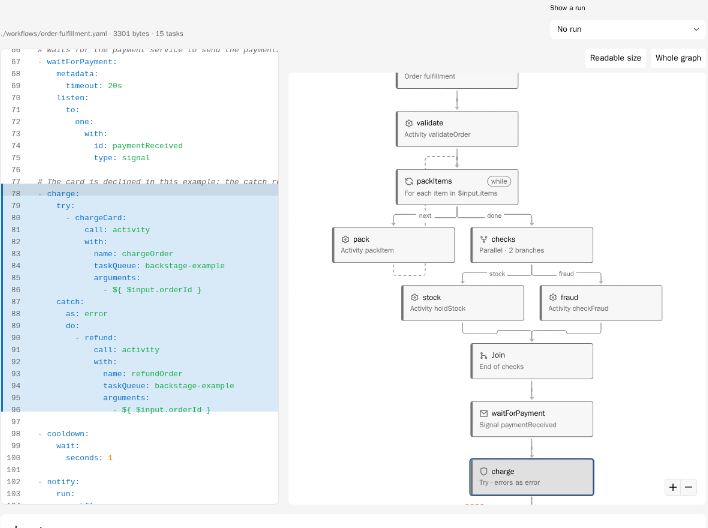
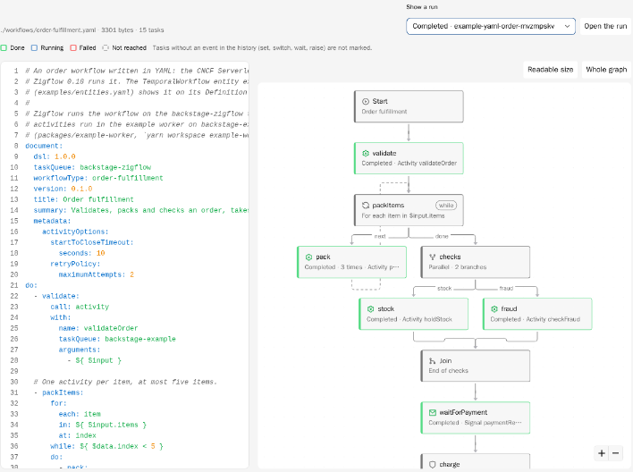

# @kwkevinchan/backstage-plugin-temporal-module-zigflow

Unofficial module of the Backstage Temporal plugin
([`@kwkevinchan/backstage-plugin-temporal-frontend`](../temporal-frontend/README.md)) with the
**Definition** tab for workflows written in the Serverless Workflow DSL and
run by [Zigflow](https://github.com/zigflow/zigflow). It reads the
definitions through the backend module
[`@kwkevinchan/backstage-plugin-temporal-backend-module-zigflow`](../temporal-backend-module-zigflow/README.md).
Apps without Zigflow workflows do not need either package.

Workflows written in YAML can show their definition on the **Definition**
tab of their `TemporalWorkflow` entity. The format is the CNCF Serverless
Workflow DSL 1.0 (now called the Open Workflow Specification) in the flavor
that [Zigflow](https://github.com/zigflow/zigflow) 0.18 runs on Temporal:
`document.dsl: 1.0.0`, `document.workflowType` and `document.taskQueue`
(the standard `document.name` works too).

| Definition tab: YAML and graph                              | A run on top of the graph                                               |
| ----------------------------------------------------------- | ----------------------------------------------------------------------- |
|  |  |

## Installation

Install the Temporal plugin first, the backend plugin (which brings the
`TemporalWorkflow` kind) and the frontend plugin (see the
[main README](../../README.md)). Without the backend module below, the tab
shows "The definition could not be loaded" and says that the backend serves
no workflow definitions.

Backend:

```sh
yarn --cwd packages/backend add @kwkevinchan/backstage-plugin-temporal-backend-module-zigflow
```

```ts
backend.add(import('@kwkevinchan/backstage-plugin-temporal-backend'));
backend.add(
  import('@kwkevinchan/backstage-plugin-temporal-backend-module-zigflow'),
);
```

The module adds its route to the Temporal backend plugin
(`/api/temporal/entities/:kind/:namespace/:name/definition`).

Frontend, new frontend system:

```sh
yarn --cwd packages/app add @kwkevinchan/backstage-plugin-temporal-module-zigflow
```

```tsx
import temporalPlugin from '@kwkevinchan/backstage-plugin-temporal-frontend/alpha';
import temporalZigflowModule from '@kwkevinchan/backstage-plugin-temporal-module-zigflow/alpha';

export default createApp({
  features: [temporalPlugin, temporalZigflowModule /* ... */],
});
```

The module adds the **Definition** tab (`entity-content:temporal/definition`)
to `TemporalWorkflow` entities.

Frontend, legacy frontend system: add the route to the `TemporalWorkflow`
page of `EntityPage.tsx`:

```tsx
import { EntityTemporalDefinitionContent } from '@kwkevinchan/backstage-plugin-temporal-module-zigflow';

<EntityLayout.Route path="/definition" title="Definition">
  <EntityTemporalDefinitionContent />
</EntityLayout.Route>;
```

The YAML is shown in a read-only [CodeMirror 6](https://codemirror.net/)
editor, using only its official packages (`@codemirror/view`, `state`,
`language`, `lang-yaml` and `@lezer/highlight`, all MIT): about 290 KB
minified (95 KB gzipped), loaded with the tab. The selected task, the cursor
and a parse error are line decorations of the editor, so they always line up
with the text.

## The entity

```yaml
apiVersion: temporal.io/v1alpha1
kind: TemporalWorkflow
metadata:
  name: order-fulfillment
spec:
  owner: group:default/orders-team
  workflowType: order-fulfillment
  taskQueue: orders-zigflow
  definition:
    format: serverless-workflow
    target: ./workflows/order-fulfillment.yaml
```

`spec.definition` has two required fields and one optional:

| Field    | Meaning                                                                                                                                           |
| -------- | ------------------------------------------------------------------------------------------------------------------------------------------------- |
| `format` | `serverless-workflow` (a YAML workflow, drawn as a graph), or `source` (the source code of a workflow written in code).                           |
| `target` | A path relative to the file the entity was read from (`backstage.io/managed-by-location`), or an absolute `http(s)` URL. At most 2048 characters. |
| `symbol` | `source` only: the function of the workflow, marked in the file (`orderWorkflow`, `OrderWorkflow.run`). Defaults to the workflow type.            |

Why this shape: `target` means the same as `spec.target` of Backstage
`Location` entities (relative or absolute), and an object with a `format`
can take other DSLs later. The file is not inlined into the entity (as
`$text` placeholders of API entities are): the catalog would store a copy
of every file in every entity, without the size limit and the checks below,
and would show changes only after the next refresh. The backend reads the
file when the tab opens instead.

Workflows written in code can show their source: `format: source` reads
the file the same way (same locations and size limit) and shows it read-only
with syntax colors (TypeScript, JavaScript, Python; Go, Java and others as
plain text), with the workflow's function marked and scrolled into view.
The function is found by text, not by parsing: a declaration of its name
(`function name`, `const name = …`, a method, `def name`, `func name`), to
its closing brace, or for Python its indented block.

```yaml
spec:
  workflowType: orderWorkflow
  definition:
    format: source
    target: ./src/workflows.ts
    # symbol: orderWorkflow   # defaults to the workflow type
```

Without `spec.definition`, the Definition tab of a workflow written in code
links to the source from the `backstage.io/source-location` and
`backstage.io/view-url` annotations, without reading any file. The links
also show above the source.

## Reading the file

- The backend reads the file with Backstage's URL reader, so only hosts of a
  configured integration (or `backend.reading.allow`) are read. A relative
  `target` is resolved against the entity's location with the integration's
  rules. Other URL schemes are rejected.
- Files above `temporal.definitions.maxBytes` (default 1 MiB, at most 8 MiB)
  are not read; the backend stops reading at the limit.
- The YAML is parsed without running anything: YAML 1.2 core schema, no
  custom tags, no merge keys, unique keys, and at most 100 aliases, so
  "billion laughs" files fail instead of filling the memory. A file that is
  not valid YAML is still shown, with the line of the error.
- Entities from `file:` locations (a development catalog) are read only with
  `temporal.definitions.readFileLocations: true`, and only files in the
  folder of the entity file or below it.
- The route is `GET /entities/:kind/:namespace/:name/definition` and needs
  `temporal.workflow.read` on the entity, like the workflow list: a
  definition describes the workflow, without inputs or results.

## The tab

- Left: the YAML, read-only, with line numbers and colors. Pressing a line
  (or moving with the arrow keys) selects the innermost task around it.
- Right: the graph, drawn and laid out like the step graph of a run (React
  Flow and dagre, top to bottom, at least 12px text at the zoom it opens
  with). Pressing a box marks its lines in the YAML and scrolls to them.

| Task                         | Drawn as                                                                                  |
| ---------------------------- | ----------------------------------------------------------------------------------------- |
| `call`, `run`, `set`, `emit` | A box with what it calls or runs (activity, HTTP, gRPC, child workflow, shell, ...)       |
| `switch`                     | A box with one arrow per case, labeled with the case, to its `then`                       |
| `fork`                       | A box, one arrow per branch, and a **Join** (or **First to finish** with `compete`) box   |
| `for` (with `while`)         | A box, an arrow into the body (`each`), a dashed arrow back (`next`) and one out (`done`) |
| `try` / `catch`              | A box, its body, a **Catch** box reached by a dashed red arrow, an arrow back for `retry` |
| `wait`, `listen`             | A box with the duration, or the signal, update or events it waits for                     |
| `do`                         | A box followed by its tasks                                                               |
| `raise`                      | A box without an arrow out                                                                |
| anything else                | A plain box marked **unsupported**; the rest of the graph is drawn as usual               |

`then: continue | exit | end | <task>` on tasks and cases are followed;
`if` and the retry policy of `metadata.activityOptions` show as badges.

## A run on top

**Show a run** lists the recent runs of the entity. The boxes of the tasks
then take the colors of the run: done, running, failed, and dimmed for
tasks the run did not reach (in a closed run) or has not reached yet. A
task that ran more than once (a loop) shows how many times. **Open the run**
opens its details on the Temporal tab.

The history of a run does not name the tasks. The tab matches events to
tasks by the names Zigflow 0.18 gives what it starts:

| Task                                                         | Event in the history                                                                                                     |
| ------------------------------------------------------------ | ------------------------------------------------------------------------------------------------------------------------ |
| `call: http`, `call: grpc`, `run` (shell, script, container) | Activity of type `<workflowType>.<task path>` (names from the top, with `try` and `catch` segments; `.` and `\` escaped) |
| `call: activity`                                             | Activity of the type in `with.name`                                                                                      |
| `run: workflow`                                              | Child workflow of the type in `workflow.type`                                                                            |
| A `fork` branch                                              | Child workflow `workflow_fork_<fork>_<branch>`                                                                           |
| The target of a `switch` case (a `do` task)                  | Child workflow named after the task                                                                                      |
| `listen` for signals or updates                              | The signals or updates by name (`all`: every one must arrive)                                                            |

Not marked, because no event names them: `set`, `switch`, `wait` (its timer
has no name), `raise`, the boxes of `do`, `for` and `try`, and tasks that
run inside a child workflow (fork branches, switch targets). A name that two
tasks share (two `call: activity` of the same activity) is not marked
either, since the history cannot tell them apart. Steps of the run that
match no task are counted under the legend.

## Configuration

Under `temporal` in `app-config.yaml`, read by the backend module:

```yaml
temporal:
  definitions:
    maxBytes: 1048576
    readFileLocations: false
```

| Key                             | Default   | Description                                                                      |
| ------------------------------- | --------- | -------------------------------------------------------------------------------- |
| `definitions.maxBytes`          | `1048576` | Largest definition file read, in bytes (at most 8 MiB).                          |
| `definitions.readFileLocations` | `false`   | Read definitions next to entities from `file:` locations (development catalogs). |
